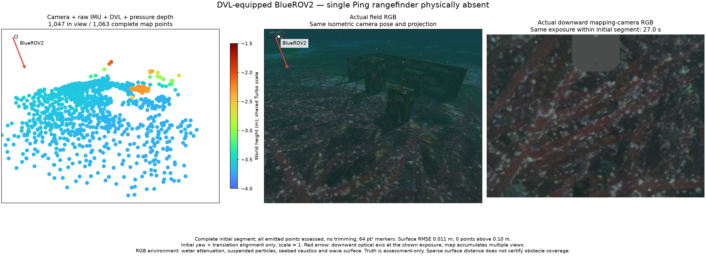
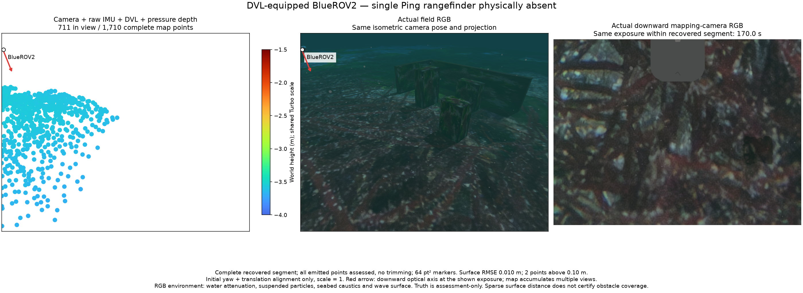

# Retain waypoint heading during vertical motion / 수직 이동 중 방위각 유지

2026-10-29 development evidence, mirrored into WWW-POSIM and independent Apache-2.0 POSIM-SLAM. `python3 summarize.py` verifies the retained complete maps, all-point assessments, actual command matching, image clocks and cleanup. No private application implementation is copied into the library. This is a controller/lifecycle check; obstacle coverage, initialization uncertainty and installed navigation remain unqualified.

## Generic controller correction

Previously, a leg with at most 1 cm horizontal displacement reverted to the mission's initial yaw. A dive or surfacing leg after a turn could therefore command another turn. The controller now retains the preceding commanded heading. Explicit waypoint headings still take precedence; horizontal travel still follows its segment bearing. The existing 1 cm classification threshold, arrival limits, trajectory safety, SLAM noise/admission/freshness/queues and sensor payloads are unchanged. The regression exercises a turn followed by dive/dwell/surface, explicit zero/nonzero yaw and the existing horizontal tolerance. The complete corrected-SDK standalone group passes 45/45 checks.

A fresh physical BlueROV2 start executes two 7×4 m, two-depth, two-cycle surveys with camera + raw IMU + DVL + pressure and no single Ping. Actual `/mavros/setpoint_raw/local` messages match all 42 planned target/heading pairs. All 13 vertical/hold legs retain their preceding yaw; the old rule would have reverted yaw in 11 of those legs on these same plans. That last number is a computed counterfactual, not an assertion that the previous run recorded those commands. `commands.json` and `command-proof.json` preserve received commands and their ordered matches. Independent truth reports about 992°/725° unwrapped heading span versus the earlier turning case's 1,535°/1,535°; repeated rotations are not independent viewing directions. Starting conditions differ, so map accuracy is not an equal-input comparison.

## Complete maps and honest comparison scope

| Segment | Complete / in-view vertices | Surface RMSE | Maximum distance | Above 10 cm | Trajectory RMSE |
| --- | ---: | ---: | ---: | ---: | ---: |
| Initial | 1,063 / 1,047 | 1.10 cm | 5.54 cm | 0 | 3.94 cm |
| Returned DVL | 1,710 / 711 | 1.03 cm | 14.18 cm | 2 | 5.74 cm |

All 2,773 emitted vertices have assessment rows and remain in the full binary PLYs. Assessment uses nearest authored surface distance, initial-yaw/translation alignment, scale 1 and independent truth brackets no wider than 50 ms. It does not prove feature identity or obstacle reconstruction. Actual DVL receiver pause/return produces exactly the intentional `dvl_stale` reset, a different frame and a complete returned map. Parent exits 0 without launch escalation and all four owned groups become empty. Minimum observed centreline distance to authored targets is 0.814 m for the unchanged 0.5 m spherical body envelope; terrain checks remain separate.

The initial RGB exposure is 27 s inside 4.6–123 s. Per-segment field/mapping stamps and frame identities pass the shared comparison renderer. Both isometric panels use the actual reference-camera pose/projection; arrows identify BlueROV2 and the downward optical axis. Markers are 64 pt² and Turbo −4 to −1.5 m. RGB includes attenuation, particles, caustics and wave surface. Orca5 mounting and the raw image's visible hull remain intact. Reference assets retain their [Orca5 MIT license](https://github.com/clydemcqueen/orca5/blob/main/LICENSE).

The returned exposure is 170 s inside 131.2–243 s. Correctly retaining the last heading also changes the bearing of the next implicit “forward” survey: the second preview starts around 91° rather than near 0°. Its field runs north of the targets. Only 711 of 1,710 points fit the fixed comparison camera; the full PLY retains all 1,710. The recovered target-coverage audit finds no visible samples on two boxes or either wall. This map therefore cannot demonstrate recovery of those obstacles. The first survey still has sparse object support (5 cm nearby samples: boxes 15/1/3, walls 9/1); the diagnostic frustum audit is an upper bound because terrain/hull/photometric occlusion is excluded.

Repeated comparison missions must reuse explicit geographic waypoints for the same survey field. They must not depend on the old implicit end-of-mission yaw reset. Preserve this consequence rather than restoring that reset to obtain a familiar-looking plot. Both final initialization statuses remain `provisional_observability_not_qualified`. Next use a fixed field for forward-versus-downward camera coverage, and keep initialization/release acceptance separate from the successful control correction.

## Source boundary

`controller-source-change.json` identifies the sole changed staged runtime file, the application's generic mission controller. `source-identity.json` binds the measured 05839d40 base plus that local candidate, component ee913f3, engine/SDK 8c47601, current-physics derivative 22b8ea23, shader 0d075c9 and the unchanged native estimator binary. The official CPython stopped-child correction remains a private asyncio-only development overlay. No shared SDK, installed app, LIVE voyage or runner is modified. Earlier source-bound map and shutdown evidence remains in the [DVL turning record](../dvl-turning-20261029/README.md).

## 한국어

수평 이동이 1cm 이내인 수직·대기 구간에서 임무 시작 방위각으로 되돌아가던 공통 제어 규칙을 고쳤습니다. 이제 직전 명령의 방위각을 유지하며, 경유점에 방위각을 지정하면 그 값을 우선합니다. 수평 이동 방향 계산, 도착·안전 여유, SLAM 잡음·점 채택·시간 제한과 센서 구성은 그대로입니다. 회전 후 잠수·대기·상승, 명시한 0 및 비영 방위각, 기존 수평 허용 범위를 회귀시험으로 확인했고 보정된 SDK에서 설치 준비 관련 회귀검사 45개를 통과했습니다.

실제 BlueROV2 두 조사에서 MAVROS로 수신한 42개 목표·방위각 명령이 계획과 일치합니다. 수직·대기 구간 13개 모두 직전 방위각을 유지합니다. 같은 계획에 기존 규칙을 대입하면 11곳에서 시작 방위각으로 돌아가므로, 이 수치는 이전 실행의 실측 명령과 구분합니다. 펼친 실측 방위각 범위는 약 992°/725°입니다. 반복 회전량을 독립 관측 방향 수로 해석하지 않습니다.

초기 1,063점과 복구 1,710점의 2,773점을 모두 보존·평가했습니다. 표면 RMSE 1.10/1.03cm, 최대 5.54/14.18cm이며 10cm 초과 0/2점도 삭제하지 않습니다. 실제 통신 단절 뒤 예상한 새 구간 한 번과 복구 지도를 확인했고 강제 종료 없이 소유 그룹 네 개가 모두 비었습니다. 기준 진실은 평가에만 사용합니다.

RGB 노출은 초기 구간의 27초, 복구 구간의 170초입니다. 각 지도 구간·노출 시각을 확인하고 같은 등각 카메라·기체·광축과 환경 효과를 표시합니다. 방위각 유지로 두 번째 ‘현재 방향으로 전진’ 조사의 방향도 약 91°로 바뀌어 표적 북쪽을 조사했습니다. 고정 비교 시야 안에는 복구 지도 1,710점 중 711점만 보입니다. 원본 지도에는 전체 점이 남습니다. 복구 구간에는 두 상자와 두 벽이 진단 시야에 들어오지 않아 장애물 복구의 증거로 쓸 수 없습니다.

같은 장면에서 방법을 비교할 때는 명시적인 지리 경유점을 재사용해야 합니다. 그래프를 비슷하게 만들기 위해 이전의 방위각 되돌림을 복원하지 않습니다. 첫 조사도 상자·벽 지지가 드물고 두 초기화 상태는 여전히 미검증입니다. 다음에는 같은 지리 영역에서 전방·하향 카메라 관측을 비교하며, 일반 항법·초기화·설치 파일 승인은 별도로 유지합니다. 비공개 앱 코드는 공개 라이브러리에 복사하지 않습니다.
