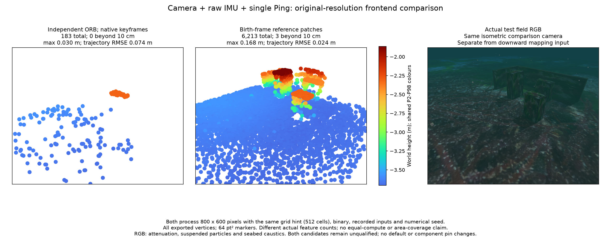

# Independent redetection control / 독립 재검출 비교

## English

Independent ORB redetection does not qualify as a replacement frontend. At 400×300 it exports no precision-admitted points. At 800×600 it exports 183 points with a 3.01 cm maximum nearest-surface distance, but supports only one of the five reference objects. The paired birth-reference patch tracker exports 6,213 points near all five objects, with three beyond 10 cm and a 16.83 cm maximum. Neither result qualifies the requested map. Defaults and selected component pins stay unchanged.

| Frontend | Processed image | Median features/image | Complete map | Beyond 10 cm | Maximum surface distance |
| --- | --- | ---: | ---: | ---: | ---: |
| ORB, previous/birth descriptors | 400×300 | 82 | 0; export fails | — | — |
| ORB, native keyframe references | 400×300 | 82 | 0; export fails | — | — |
| Birth-reference patches | 400×300 | 303 | 1,497 | 3 | 35.92 cm |
| ORB, native keyframe references | 800×600 | 216 | 183 | 0 | 3.01 cm |
| Birth-reference patches | 800×600 | 790 | 6,213 | 3 | 16.83 cm |

All five runs process the same 1,219 original camera exposures, raw IMU and single-Ping ranges, 16 startup exposures and recorded numerical seed. The keyframe/patch pairs share one binary and calibration within each processing budget. Original sensor times and supplied source pixels are preserved. No simulator pose, depth image or physical surface enters estimation. Initial yaw and translation alignment preserve gravity tilt and scale 1 for post-estimation assessment.

The low budget is 120,000 processed pixels with a 200-cell grid hint. The larger budget is 480,000 pixels with a 512-cell hint. These hints produce different actual feature counts in each algorithm; they are not equal-compute limits. The assumed observation sigma remains 0.5 processed pixels, so changing resolution also changes its angular meaning. These measurements do not isolate image resolution as a cause or calibrate that noise assumption.

The candidate uses OpenCV 4.13.0 ORB, subpixel corner refinement, mutual Hamming ratio matches and per-reference-view homography/fundamental USAC MAGSAC verification. Descriptor ties, conflicting identities and unavailable numerical models cannot establish an inherited association. Its keyframe version receives the exact retained Basalt keyframe timestamps after camera updates. At most eight keyframes, sixteen pending views and the previous view are held, counting shared entries once. This is a bounded descriptor experiment, with no ORB-SLAM code or new dependency.

Keyframe references increase IDs observed at least twenty times from 92 to 818 at the low budget. They do not recover a precision-admitted map there. At the larger budget, all 183 admitted points lie within 10 cm of a physical surface: 154 are nearest the seabed and 29 are nearest one test object. The other two objects and both walls have zero support. The patch control has 197/267/122 points nearest the three objects, 80/115 nearest the two walls and 5,429 nearest the seabed within 10 cm. These are nearest-surface assignment counts, not physical feature-identity or area-coverage proofs. Trajectory RMSE is 7.39 cm for ORB and 2.42 cm for patches at the larger budget.

The native probe covers 30 blank exposures followed by reobservation, reference retirement, geometry degeneracy and a stalled-backend bound. Its translation p90 error is 0.00244 px; descriptor references peak at 348 against a fixture limit of 4,800. The field keyframe reference peaks are 914 and 2,278 for the two budgets. Native regression executes 47 tests, with six optional checks skipped. These checks establish implementation behavior, not map acceptance.

Complete PLYs, every-point assessments, matched RGB/PCL figures, receipts, feature lifetimes and per-frame reports are retained. The 400×300 patch PLY is byte-identical to the [existing complete map](../reference-patch-control-20261028/patch/worker-map.ply), SHA-256 `6372b01f4a632b3416beeb5c0edcaffcb9139ab3dc01cac5bd60686b21e1b56c`, so it is referenced instead of duplicated. Failed runs have no fabricated empty PLY or surface accuracy.

The unused runtime frontend and application acceptance changes are removed. [candidate-source.patch.gz](candidate-source.patch.gz) preserves the Apache-2.0 library candidate against POSIM-SLAM `714dba7bc592efc0317b4e07d4cdcded41cb28f1`; it is source-only and not selected or built by this report. It can be applied in a separate checkout for native probe reproduction. Exact worker binaries, raw recordings and field replay harnesses remain local; this public bundle alone cannot rerun the field. Receipt `passed` describes input processing/export, while every map remains unqualified. The client intentionally stops the worker after the result, producing exit code -15 and stopped transport threads. ROS recovery, initialization covariance, GUI, installed-app and platform acceptance remain separate.

The figure projects every exported vertex through the same isometric comparison camera. The source RGB is separate from the downward mapping input. All points remain in each PLY, including those outside the figure. Both maps share Turbo height normalization and 64 pt² markers. RGB includes attenuation, suspended particles and seabed caustics.

## 한국어

독립 ORB 재검출은 대체 추적기로 채택하지 않습니다. 400×300에서는 정밀도 기준을 통과한 지도 점이 0개여서 내보내기가 실패했습니다. 800×600에서는 183점의 최대 표면 거리가 3.01cm였지만, 다섯 시험 물체 중 하나 근처에만 점이 있습니다. 같은 설정의 최초 참조 패치 추적은 6,213점으로 다섯 물체 근처에 점을 만들었으나, 3점이 10cm를 넘고 최대 거리는 16.83cm입니다. 두 결과 모두 요청한 지도의 완성으로 인정하지 않습니다. 기본값과 선택한 컴포넌트 버전은 유지합니다.

다섯 실행 모두 동일한 원본 카메라 1,219장, 원시 IMU·단일 Ping, 초기 노출 16장과 기록된 초기 계산값을 사용합니다. 키프레임·패치 쌍은 각 처리 예산에서 같은 실행 파일과 보정값을 씁니다. 원본 센서 시각과 전달 영상은 보존하고, 정답 자세·깊이 영상·물리 표면을 추정기에 넣지 않습니다. 평가는 첫 yaw·평행이동만 정렬하며 중력 기울기와 배율 1을 유지합니다.

작은 예산은 처리 화소 120,000개·격자 힌트 200셀, 큰 예산은 480,000개·512셀입니다. 실제 특징점 수가 다르므로 같은 연산량 비교가 아닙니다. 관측 시그마 가정은 처리 영상에서 0.5px로 유지되어 해상도에 따라 각도상 의미도 달라집니다. 해상도만의 인과 효과나 잡음 보정을 입증하는 결과는 아닙니다.

후보는 기존 OpenCV 4.13.0의 ORB·서브픽셀 코너 보정·양방향 Hamming 비율 매칭·참조 영상별 USAC MAGSAC 기하 검증을 사용합니다. 서술자 동률·ID 충돌·수치 모델 실패는 기존 ID를 계승하는 근거가 될 수 없습니다. 키프레임 방식은 Basalt가 카메라 갱신 뒤 실제 보존한 키프레임 시각을 전달받습니다. 키프레임 최대 8개, 미확인 영상 16개, 직전 영상 1개를 보관하고 중복은 한 번 셉니다. ORB-SLAM 코드나 새 의존성은 포함하지 않습니다.

작은 예산에서 20회 이상 관측된 ID는 키프레임 참조로 92개에서 818개로 늘었지만, 정밀도 기준을 통과한 지도는 생기지 않았습니다. 큰 예산의 재검출 지도 183점은 해저면 154점·물체 하나 29점으로 나뉘며 다른 두 물체와 두 벽은 0점입니다. 패치 지도에서 10cm 이내의 최근접 표면별 점 수는 세 물체 197/267/122점, 두 벽 80/115점, 해저면 5,429점입니다. 이는 최근접 표면 배정 수이며 물리 특징점 대응이나 면적 재구성을 증명하지 않습니다. 큰 예산의 궤적 RMSE는 재검출 7.39cm, 패치 2.42cm입니다.

네이티브 검사는 빈 노출 30장 뒤 재관측, 참조 해제, 퇴화 기하와 추정기 지연 상한을 확인합니다. 평행이동 p90 오차는 0.00244px이며 시험 참조 최대치는 348개, 해당 시험 상한은 4,800개입니다. 실제 키프레임 비교의 참조 최대치는 두 예산에서 914개·2,278개입니다. 네이티브 회귀 검사 47개가 통과하고 선택 검사 6개는 생략했습니다. 이것은 구현 동작 검증이며 지도 합격 판정이 아닙니다.

전체 PLY·모든 점의 평가·RGB/PCL·실행 기록·특징점 수명·프레임별 보고를 보존했습니다. 400×300 패치 PLY는 위 기존 지도와 바이트가 같아 중복 저장하지 않습니다. 내보내기에 실패한 실행에는 빈 PLY나 정확도 수치를 만들지 않았습니다.

사용하지 않는 런타임 선택지와 앱의 승인 처리는 제거합니다. 압축 소스 차이는 위 POSIM-SLAM 커밋 기준의 Apache-2.0 후보를 보존하며, 별도 체크아웃에서 네이티브 검사를 재현할 수 있습니다. SDK·실행 파일·비공개 앱 소스는 포함하지 않습니다. 실제 워커 실행 파일·원본 센서 기록·현장 재생 도구는 로컬에 남기므로 공개 묶음만으로 현장 기록을 재생할 수는 없습니다. `passed`는 입력 처리·내보내기 결과이며 모든 지도는 미검증입니다. 결과 뒤 워커를 의도적으로 종료한 -15 코드와 송수신 스레드 정지를 기록했습니다. ROS 복구·초기화 공분산·GUI·설치형 앱·플랫폼 검증은 별도로 남습니다.

그림은 같은 등각 방향 비교 카메라와 공통 Turbo 높이 색 범위, 64pt² 점으로 전체 내보내기 지도를 표시합니다. 화면 밖 점도 PLY에 포함됩니다. RGB는 하향 매핑 입력과 별도 카메라에서 촬영했으며 감쇠·부유 입자·해저 집광무늬가 적용됩니다.
