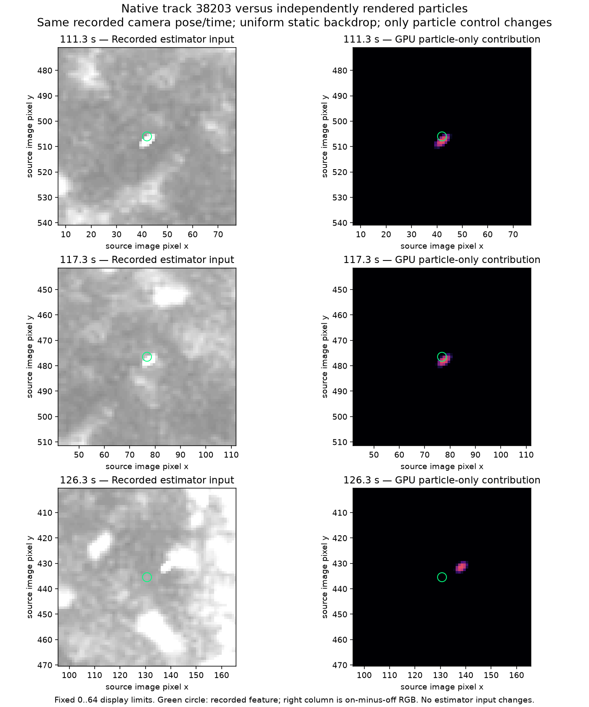
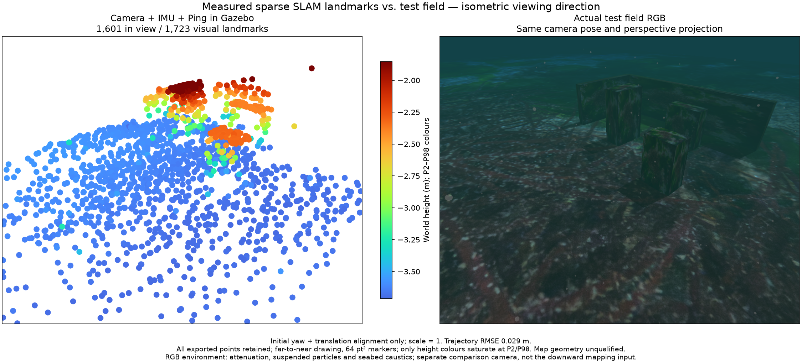

# Suspended particles and static-map identity / 부유 입자와 고정 지도 특징

2026-10-28. **Renderer geometry and SLAM accuracy have separate results.**
The proposed renderer passes its geometric controls. The new native SLAM map
still fails. The application keeps POSIM at `8c47601`; the shader is an explicit
experimental source override, not a change to installed assets or defaults.

## Source attribution

The earlier camera/IMU/Ping field exports a point 2.676 m from a physical surface.
Its native ID 38203 survives 151 frames over 15 s and ends with a 0.575 px
reprojection residual. The complete map and original source hashes remain in
the camera/IMU profile evidence. Track duration and a small residual do not
establish static physical correspondence.

The selected renderer samples procedural dust on rays at camera-relative
distances 0.8, 1.6 and 2.4 m. Its sample location is `camera + ray * distance`;
the pattern does not assign a camera-independent centre to each particle.

A separate GPU fixture uses the actual field shader, recorded camera pose and
simulation time, and a uniform static backdrop. It renders specks off and on
at the same pose/time. Only this control changes. The initial and middle track
samples coincide with the particle-only contribution. The last sample is
displaced from that contribution, consistent with an appearance/track-identity
problem. The fixture is not a pixel-exact recreation of the terrain scene.

Left: preserved full-resolution estimator gray8 crops. Right: mean RGB
on-minus-off contribution. Both use the recorded image coordinates. Display
limits are fixed at 0–64; source pixels are unchanged. Green circles mark the
native feature coordinates. [Attribution inputs and hashes](particle-attribution.json),
[recorded camera poses](source-camera-poses.txt),
[complete outlier-track summaries](original-outlier-tracks.json).

## Proposed renderer contract

The experimental POSIM branch `codex/world-particle-optics` gives specks centres
in 0.25 m world cells with uniform visual drift `(0.004, 0.008, 0)m/s`.
Every camera at a given time uses those same centres. Standard 3D DDA traverses
at most 24 crossed cells over a 3 m water path. Ray/particle distance sets
coverage; opaque scene geometry clips it. This is an optical approximation,
separate from fluid simulation, acoustic rays and pressure.

The native source build and settings CTest pass. The default shader's
deterministic control checks four known particles from four translated camera
positions and after advancing time. It fixes only cell selection and sub-cell
jitter; production traversal, drift, coverage and clipping remain. Maximum
independent-projection error is **0.0702 px** over 20 checks. A nearer opaque
surface hides all test particles, and numeric depth is byte-identical with
specks off/on. The enhanced profile also passes, at **0.0730 px** maximum.
These are macOS Metal controls, not Windows/Linux execution proof.

The 800×600 uniform-backdrop fixture measures median specks-on RGB capture
**1.59 ms** for the selected shader and **1.89 ms** for the candidate. Each row
averages 30 warmed captures; three recorded poses are used. This excludes the
full scene, ROS and encoding. [Projection/depth/occlusion receipt](renderer-projection.json),
[performance rows](renderer-performance.json), [source hashes](renderer-sources.json).

The first attribution executable loaded two SDK rendering-library instances
and failed before rendering. Its private log is retained. The working fixture
binds the helper and rendering engine to one SDK library set. That setup
failure is not a SLAM or image result.

## Fresh native camera + IMU + Ping field

The actual managed Gazebo/ArduPilot survey uses the candidate shader with the
same VIO worker, source-bound input profile, physical payload and precision
budget. It completes in **73.64 s**. The 120 s observation retains **1,195 poses**
in one segment after intentional worker recovery and exports all **1,723 points**.
Position RMSE is **2.93 cm**. Inbox rejections are zero; no queue fault or owned
process remains. Exit is 0 without forced shutdown.

| Fresh physical recording | Map points | P95 surface distance | Maximum | Points >10 cm |
| --- | ---: | ---: | ---: | ---: |
| Selected camera-distance specks | 1,574 | 2.03 cm | 267.60 cm | 16 |
| Experimental world-space specks | 1,723 | 2.84 cm | 146.77 cm | 27 |

These are separate physical recordings, not a paired causal ablation. The
candidate is **not a map-accuracy improvement claim**. Moving suspended matter
and non-static illumination still need correct feature association and static
map ownership. Linearized joint uncertainty remains conditional on that model.
No map threshold, original sensor timestamp or estimator code changes here.

Every exported point enters projection and physical-surface assessment. The
same observer camera and bounds produce RGB and PCL. Alignment is initial
yaw/translation only, with scale one. Simulator geometry is evaluation-only;
points are not trimmed using truth. RGB includes attenuation, suspended
particles and seabed caustics. Markers are 64 pt², drawn far to near; P2/P98
affects Turbo colours only. The observer is separate from the downward
estimator camera.

[Complete PLY](map.ply), [every assessed vertex](surface-evaluation.json),
[native summary and original receipt hash](native-summary.json),
[comparison provenance](native-comparison.json),
[72 component/eight runtime fingerprints](source-manifest.json).
The same matched field record is preserved in WWW-POSIM and POSIM-SLAM.

The renderer uses established grid traversal
([Amanatides and Woo, 1987](https://www.cse.yorku.ca/~amana/research/grid.pdf)).
No algorithmic novelty is claimed. Benchmark validity and false static-track
admission are potential empirical questions; they require controlled repeats
and literature comparison before a research contribution can be claimed.
The full SLAM, sonar, GUI/distribution and platform goal remains incomplete.

## 한국어

기존 지도에서 표면 오차 2.676m인 ID 38203은 15초·151프레임을 유지하고 마지막
재투영 오차가 0.575픽셀이었습니다. 원본 자세·시각과 실제 셰이더로 입자 켬·끔만
바꾼 별도 GPU 시험에서 트랙의 시작·중간 위치가 입자 기여와 겹칩니다. 마지막
특징은 입자 위치에서 벗어나 있어 같은 ID가 같은 물리적 특징을 유지하는지도
문제입니다. 위 그림은 원본 회색조 입력과 독립 렌더링의 차이를 같은 좌표로 보이며,
지형 장면 전체를 픽셀 단위로 재현한 시험은 아닙니다.

실험용 렌더러는 카메라 기준 거리층 대신 세계 좌표의 입자 중심과 일정한 시각적
이동을 사용합니다. 네 카메라 위치와 시간 경과의 20개 투영 검사에서 최대 오차는
0.0702픽셀이며 가림과 깊이 바이트 동일성도 통과했습니다. 강화된 표현은 최대
0.0730픽셀입니다. 800×600의 단순 배경 시험에서 입자 켬의 중앙값은 1.59ms에서
1.89ms로 변합니다. 전체 장면 성능·유체 모사·다른 플랫폼 검증과는 구분합니다.

새 실제 네이티브 실행은 항로를 73.64초에 완료하고 1,195개 자세와 전체 1,723점을
보존합니다. 위치 RMSE는 2.93cm지만 지도는 10cm 초과 27점·최대 1.47m이므로
**지도 정확도는 실패**입니다. 이전 1,574점·16개 오점 기록과는 별도 물리 실행이므로
인과적 개선을 주장하지 않습니다. 입자 위치의 일관성과 SLAM의 고정 특징 판별은
서로 다른 문제입니다. 모든 점·실패·수치 평가와 같은 등각 방향 RGB/PCL을 보존합니다.

현재 앱의 POSIM 핀은 `8c47601`로 유지하며, 이번 실행은 명시적인 실험용 셰이더
경로를 사용합니다. 설치 파일·기본값·추정기·정밀도 문턱은 바꾸지 않았습니다.
기존 DDA 방식의 사용이며 새로운 알고리즘의 독창성을 주장하지 않습니다. 렌더링
근사로 인한 잘못된 고정 특징은 후속 실험 후보로 기록하고, 전체 목표는 미완료입니다.
