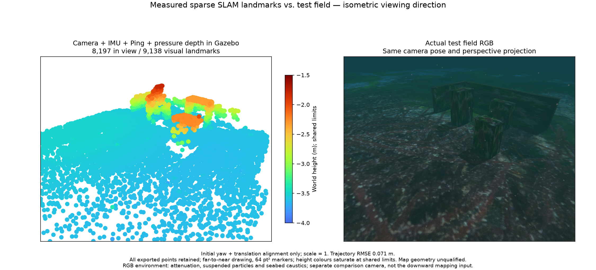
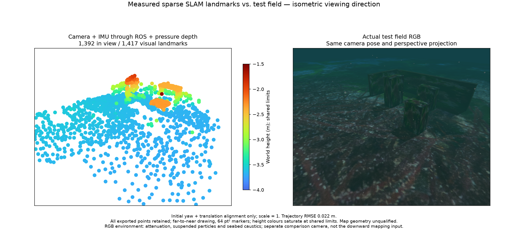
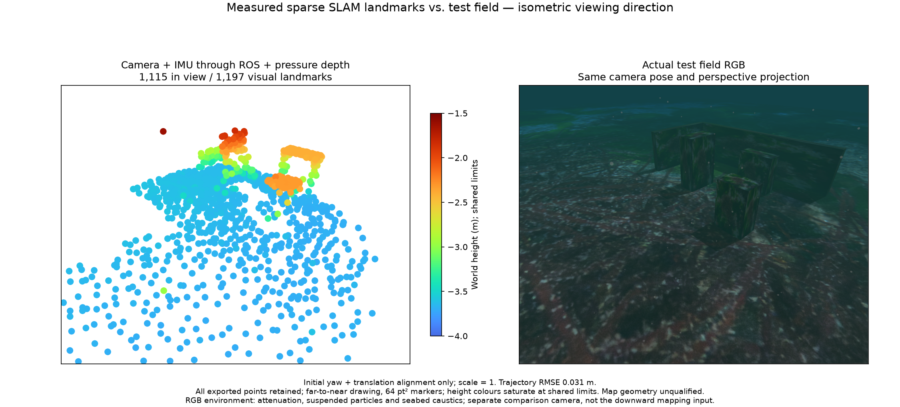

# Pressure fusion and event-paced IMU delivery — 2026-10-28

Camera/IMU/Ping and mounted pressure complete a two-depth managed Gazebo survey after an intentional native-worker termination. The restored segment retains 1,125 poses and exports all 9,138 landmarks. The previous same-recipe field lost its map after a late `imu_backlog` reset. **Transport/recovery passes; map accuracy and installed-app acceptance remain unqualified.**

## Method and evidence

The application selects physical pressure independently of imaging sonar. Native hydrostatic-height factors retain the sensor offset, measured variance and a shared unknown height datum. Pressure optimization is checked separately from message reception. The managed run includes 113 optimized pressure states.

`EventImu` supplies each camera or auxiliary state with the original contiguous IMU interval through the first strictly later sample. Future measurements remain in the existing bounded history until another state is released. Both camera and camera-free sonar use this independent helper. Its four unit controls and the eleven affected sonar-session controls pass; the camera owner also tests auxiliary events and repeated ticks without acknowledgement.

The old field forwarded raw IMU immediately while camera/auxiliary states waited for acknowledgement. Its last reported received-IMU lead was 2.62 seconds at 100 Hz; native capacity is 256 samples. The new managed run's transmitted-IMU lead is at most 10 ms. Native capacity, the 4 MiB client pipe, stale deadlines, IMU noise and the 0.1 m world-position three-sigma map criterion are unchanged by event pacing. The separate pending-camera allowance is derived from camera rate and a 64 MiB bound so a pressure outage can reach its existing two-second stale deadline.

Native worker SHA-256: `cb5cbc7c254b668ea0b0e3c7ac0f2fe8dac0d4f07810bab2e8d3237ca18d1d87`.
Basalt upstream: `0f3b2b52c807f70ff4e2973ce253c73329eea7bc`; POSIM-SLAM 0.1.0.
The native binary is unchanged. Pressure is an existing factor; this integration adds no third-party dependency.

The checked field spans 7 m × 4 m, with two lanes, two cycles, 0.6/1.2 m depths, fixed survey heading and terminal surfacing. Authored-target body clearance is 0.832 m against a 0.5 m requirement; terrain is checked separately by the mission planner. All four owned process groups are empty after normal shutdown.

This managed example uses 480,000 pixels, 512 feature cells and reference-patch tracking. All 9,138 exported points are retained; 8,197 fall inside the comparison camera. The RGB and cloud use the same isometric viewing direction and perspective. RGB includes underwater attenuation, suspended particles and seabed caustics. The shader is an explicit experiment override, not the selected engine's default. It comes from the local POSIM particle candidate. The comparison camera is separate from the downward mapping camera.

## Default processing budget without Ping

A separate 1× actual ROS replay uses the managed field's recorded camera, raw IMU and pressure. It has no Ping subscription, publication, pairing or factor. The production processing defaults are 120,000 pixels, 200 cells and frame-to-frame tracking. IMU interruption clears the old map; measured inputs return on their original timestamps and produce a new segment. Initial/recovered pressure optimization counts are 52/50. This is a recorded ROS test, not another live managed or installed-app qualification.

These maps retain every point and use the same scene, Turbo height limits and 64 pt² markers. The field run and the default replay differ in both processing profile and selected inputs; their numbers are not a controlled attribution of quality to Ping.

| Result | Full points | Surface RMSE | P95 | P99 | Maximum | Above 10 cm | Trajectory RMSE |
| --- | ---: | ---: | ---: | ---: | ---: | ---: | ---: |
| Managed + Ping + pressure | 9,138 | 6.40 cm | 7.12 cm | 7.86 cm | 34.03 cm | 21 | 7.14 cm |
| Default, no Ping, initial | 1,417 | 5.85 cm | 1.90 cm | 24.75 cm | 86.80 cm | 27 | 2.15 cm |
| Default, no Ping, recovered | 1,197 | 8.45 cm | 2.90 cm | 8.53 cm | 199.20 cm | 11 | 3.13 cm |

The default maps contain large outliers; successful transport does not accept their geometric quality. Simulator geometry is used only after estimation. Alignment uses initial yaw and translation at scale 1, with no trajectory fit or truth-based point removal. Nearest-surface counts do not prove physical landmark correspondence or recovered area. Default managed operation, interactive sensor switching, acoustic mapping and other platforms remain separate work.

Run `python3 summarize.py` inside this directory. It verifies exact PLY sizes, every vertex index, all-point statistics, source-hashed recovery proofs, default processing settings and clean managed shutdown. It does not rerun the estimator or independently reconstruct the evaluation geometry. Full raw recordings remain in the private development workspace; this kit contains outputs and hashes, not private application source.

## 한국어

카메라·IMU·Ping·압력을 사용하는 실제 Gazebo 임무는 의도한 워커 종료 뒤 복구한 한 구간에서 자세 1,125개와 전체 점 9,138개를 보존했습니다. 동일한 임무 설정의 이전 실패에서 확인한 native IMU 큐 초과를 상태별 원본 구간 전송으로 해결했습니다. 큐·잡음·지도 불확실성 기준을 완화하지 않았습니다. 압력 수신과 실제 최적화 반영은 구분합니다.

기본 예산·Ping 없는 조합은 실제 ROS 1배속 기록 재생에서 IMU 유실과 복구를 통과했습니다. 초기 1,417점과 복구 1,197점을 모두 공개하며 큰 이상점도 제거하지 않았습니다. 입력·복구 통과를 지도 정확도 합격으로 인정하지 않습니다. 이 자료는 설치형 앱이나 소나 지도 전체의 합격 증거가 아닙니다.

모든 비교는 같은 등각 방향·투영과 높이 색 범위를 사용합니다. RGB에는 수중 감쇠·부유 입자·해저 집광무늬가 있으며 비교용 별도 카메라입니다. 실험용 셰이더를 사용했음을 구분합니다. 전체 PLY·점별 평가·정상 종료 증거·해시 검증 스크립트를 보존합니다.
