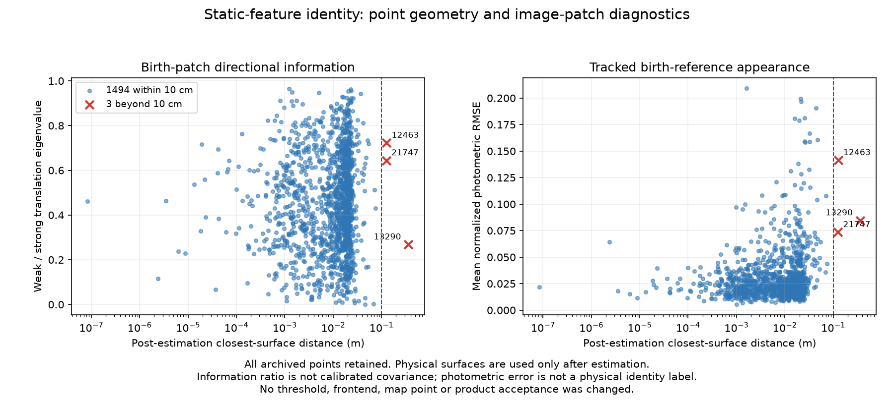
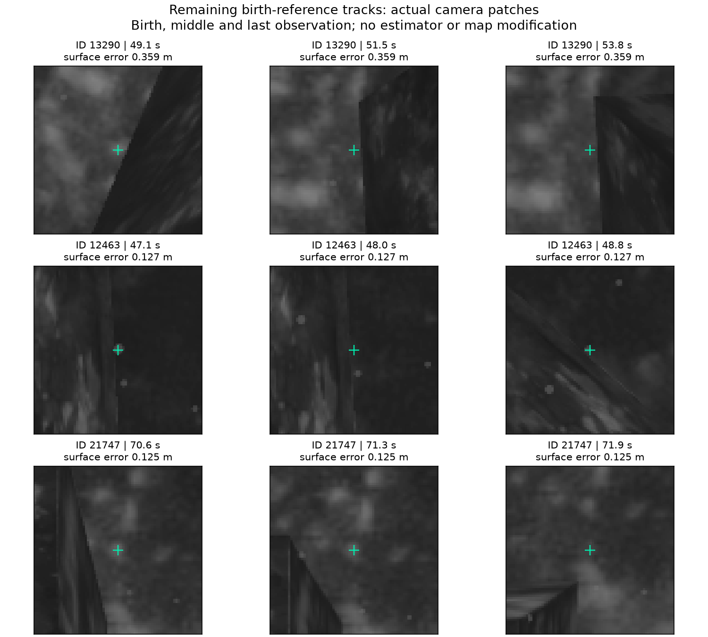

# Reference observation model / 최초 참조 관측 모델

The complete map remains **1,497 points, three beyond 10 cm, maximum surface distance 0.359 m**. It remains unqualified. These diagnostics do not change the estimator, images, map, admission rules or application defaults.

The retained source field uses an explicit experimental world-space particle shader override. Its environment and source fingerprints remain in the linked map report; the selected application engine is unchanged.

## English

The native photometric replay processes all 1,235 original exposures: 16 startup images and 1,219 estimation images. All 76,222 selected archived-feature observations match the original IDs and coordinates exactly. No IMU, truth or geometric surface is fed to this replay; it measures the existing camera frontend only.

We evaluate the normalized Pattern51 photometric Hessian at the birth and last observations of every archived point: 2,994 cases. Rotation is eliminated before measuring the two translation directions. The three failed birth ratios are 0.723, 0.268 and 0.644; the all-point median is 0.443. Their weakest-direction information is higher than the all-point median. A simple weak-feature or endpoint anisotropy cutoff does not isolate these failures. This does not exclude intermediate degeneracy, correlated template noise or wrong physical correspondence. The ratio is not calibrated pixel covariance.

The failed tracks have mean normalized birth-reference RMSE 0.141, 0.085 and 0.074; the all-point median is 0.022. Accurate points also have large residuals, so this is not a validated classifier or an acceptance threshold. The frontend's existing forward/backward tracking and geometric reprojection tests do not by themselves establish physical feature identity.

The independent local warp comparison uses the same fixed visible samples, brightness-gain normalization and decreasing-cost inverse-compositional fitting for SE2 and six-parameter affine models. Sixteen known planar-image controls across four fixed texture seeds pass; maximum affine centre error is 0.0834 px. All 1,497 actual birth/last pairs are retained. The all-point median RMSE changes from 0.0247 to 0.0191. For the three failures it changes only from 0.1392 to 0.1384, with median centre shift 0.0474 px. Adding local affine refinement around the final supplied match does not resolve these cases. This is not a test of a complete multiscale affine frontend, nor proof that all geometric deformation is irrelevant.

The crops use the actual source pixels with the area-resize centre convention `(u + 0.5) * source / processed - 0.5`. They show apparent texture changes near edges and contrast patterns. They do not independently label particles, caustics, occlusion or physical landmark motion.

The optional native tools are in [the independent recipe](https://github.com/IOES-Lab/POSIM-SLAM/tree/codex/reference-patch-tracking/native/basalt/diagnostics) in POSIM-SLAM. They are excluded from the default build. Actual component targets reproduce all 76,222 observations bit for bit, all 2,994 information cases, all 1,497 local warp pairs and the 16 synthetic controls. Malformed/truncated packets, duplicate clocks, black references and empty-support fits have bounded, clean termination. This is macOS SDK diagnostic evidence, separate from estimator accuracy, ROS recovery, GUI and distribution qualification.

The next model question is physical static-point identity across independently observed viewpoints, including changing appearance and possible landmark motion. No image-error gate, covariance inflation or truth-based point deletion is introduced from these three examples. The original full PLY, all-point errors and failed tracks remain in [the matched-map report](../reference-patch-control-20261028/README.md). Full raw frames and traces remain local; these reports alone are not a public raw-data replay package.

- [Summary and source fingerprints](summary.json)
- [All-point information](all-point-information.json.gz), [photometry](all-point-photometry.json.gz), [local warp fits](all-point-warp-comparison.json.gz), lossless JSON gzip
- [Synthetic controls](affine-synthetic.json) and [component equivalence/lifecycle controls](component-verification.json)

## 한국어

지도는 **전체 1,497점, 10cm 초과 3점, 최대 표면 거리 0.359m**로 유지되며 미검증 상태입니다. 추정기·영상·지도·점 채택 규칙·앱 기본값은 바꾸지 않았습니다.

원본 필드는 실험적인 월드 좌표 입자 셰이더를 명시적으로 지정한 기록입니다. 환경·소스 해시는 연결한 지도 보고서에 남아 있으며 앱의 선택 엔진은 유지합니다.

시작 영상 16장과 추정 영상 1,219장, 총 1,235개 원본 노출을 네이티브 광학 추적기로 다시 처리했습니다. 지도에 남은 특징점의 관측 76,222개가 원래 ID·좌표와 정확히 일치합니다. 이 재생은 기존 카메라 추적만 검사하고 IMU·정답·물리 표면을 입력하지 않습니다.

모든 지도 점의 최초·마지막 패치, 총 2,994개에서 정규화 Pattern51 광도 Hessian을 구하고 회전을 소거한 두 위치 방향을 비교했습니다. 세 실패점의 최초 약한 방향/강한 방향 비율은 0.723·0.268·0.644이며 전체 중앙값은 0.443입니다. 약한 방향의 정보량도 전체 중앙값보다 높습니다. 약한 특징이나 양 끝 패치의 방향 비율만으로 세 실패를 분리할 수 없습니다. 중간 시점의 퇴화·참조 잡음의 상관·잘못된 물리적 대응을 배제한 것은 아니며, 이 비율은 보정된 픽셀 공분산이 아닙니다.

실패 트랙의 최초 참조 대비 평균 정규화 RMSE는 0.141·0.085·0.074, 전체 중앙값은 0.022입니다. 정확한 점에도 큰 광도 잔차가 있어 검증된 분류기나 채택 임계값을 뜻하지 않습니다. 기존 왕복 추적·기하 재투영 검사만으로 같은 물리점을 본다고 보장하지는 못합니다.

같은 고정 가시 표본과 밝기 배율 정규화로 SE2·6변수 affine 국소 정합을 비교했습니다. 고정한 네 가지 텍스처의 평면 변환 16개에서 최대 affine 중심 오차는 0.0834px입니다. 실제 1,497개 최초/마지막 쌍을 모두 보존했습니다. 전체 중앙 RMSE는 0.0247→0.0191이지만, 세 실패에서는 0.1392→0.1384에 그쳤고 중앙 중심 이동은 0.0474px입니다. 마지막 대응점 주변의 국소 affine 보정으로 이 사례가 해결되지는 않습니다. 전체 다중 해상도 affine 추적기를 시험하거나 모든 기하 변형이 무관함을 증명한 결과는 아닙니다.

원본 크롭은 면적 축소의 픽셀 중심 규약을 사용합니다. 모서리·대비 무늬 부근의 변화를 볼 수 있지만 입자·집광무늬·가림·물리점 이동을 독립적으로 판정한 자료는 아닙니다.

별도 빌드하는 네이티브 진단 대상은 관측 76,222개를 비트 단위로 재현하고, 정보 검사 2,994개·실제 변형 쌍 1,497개·합성 검사 16개와 일치했습니다. 잘못된·잘린 패킷, 중복 시각, 검은 참조, 표본이 없는 참조도 제한된 시간 안에 정리됩니다. macOS SDK 진단이며 추정 정확도·ROS 복구·GUI·배포 검증과는 구분합니다.

다음 검증 대상은 서로 독립적인 시점에서 같은 정적 물리점을 보는지와, 변하는 외관·물리점 이동의 구분입니다. 이 세 사례로 영상 오차 필터·공분산 부풀리기·정답 기반 삭제를 추가하지 않았습니다. 전체 PLY와 모든 점의 오차·실패 이력은 기존 비교 기록에 남아 있습니다. 원본 센서 프레임·전체 추적은 로컬에 있으므로 이 보고 파일만으로 공개 원본 데이터를 재생할 수는 없습니다.
