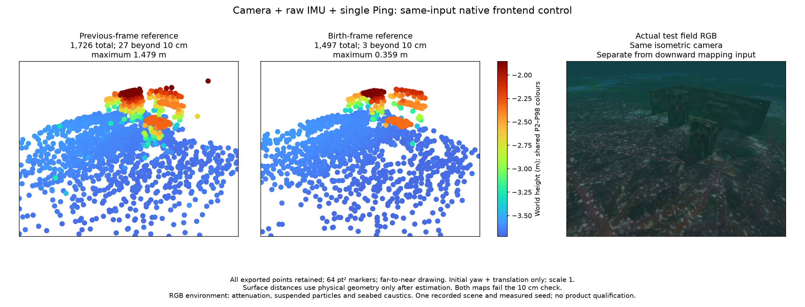

# Same-input reference-patch control / 동일 입력 참조 패치 비교

## English

The native worker processes the same 1,219 original camera frames, raw IMU and single-Ping ranges from 14.5–136.3 s. Both runs use the same binary, native source snapshot, calibration, 16 startup images and recorded measured numerical seed. Only `optical_flow_type` differs. Sensor times and full source pixels remain unchanged. No simulator pose, depth image or physical surface enters estimation.

| Native frontend | Complete map | Points beyond 10 cm | Maximum surface distance | Trajectory RMSE |
| --- | ---: | ---: | ---: | ---: |
| Previous-frame reference | 1,726 | 27 | 1.479 m | 4.18 cm |
| Birth-frame reference | 1,497 | 3 | 0.359 m | 2.39 cm |

Each complete PLY, vertex identity, all-point surface assessment, native receipt and matched RGB/PCL figure is retained in its method folder. Every vertex is assessed against the static collision geometry and seabed after estimation. Initial yaw and translation alignment preserve gravity tilt and scale 1. Nearest-surface distance does not establish physical feature identity or area coverage. Neither map passes the 10 cm check. The default tracker remains previous-frame.

The worst birth-reference point (ID 13290) lasts 48 frames and finishes with a 0.860 px reprojection error and 0.0203 m joint position sigma, yet lies 0.359 m from the closest physical surface. Small residuals and linearized covariance do not resolve wrong correspondence or observation-model bias. All three failures remain in the exported map. No brightness, height, duration or truth-based deletion was added.

The upstream Basalt reference tracker retains birth patches. A checked build-local overlay retires a patch after its identity disappears from every camera view, after parallel tracking/filtering completes. The 400-frame native lifecycle probe includes 100 blank frames; its measured peak is 57 against a fixture bound of 162 and all blank frames retain zero references. The field control peaks at 433 references. This bounds historical accumulation by current observations, not process RSS or a global fixed feature cap. Basalt supplies both tracking algorithms; no algorithmic novelty is claimed.

The overview uses common height normalization and the same isometric camera for both complete maps and actual RGB. Points outside that camera remain in the PLY and total count. Markers are 64 pt². RGB includes attenuation, suspended particles and seabed caustics and comes from a comparison camera, separate from the downward mapping input.

This is a conditional native IPC comparison on one recorded scene and measured seed. Runtime `passed` means input processing and complete export; `map_qualified` remains false. Both clients deliberately terminate the worker after export (exit -15), with stopped input/output threads. Initialization covariance, new live recordings, timing/throughput, ROS loss/recovery, GUI selection and installed-platform operation remain separate acceptance tasks. The full raw recording and traces remain local; these report artifacts alone are not a public raw-data reproduction package.

- [Complete summary and source/input fingerprints](summary.json)
- [Previous-frame full PLY](frame_to_frame/worker-map.ply) and [all-point assessment](frame_to_frame/visual-surface-evaluation.json)
- [Birth-frame full PLY](patch/worker-map.ply) and [all-point assessment](patch/visual-surface-evaluation.json)
- [Birth-frame worst-track histories](patch/worst-tracks.json)
- [Native lifecycle probe](lifecycle-probe.log) and [invalid native-setting controls](invalid-native-frontends.json)

## 한국어

두 네이티브 실행에 14.5–136.3초의 동일한 원본 카메라 1,219프레임, IMU, 단일 Ping 거리를 입력했습니다. 실행 파일·네이티브 소스 스냅샷·보정값·시작 영상 16장·기록된 측정 기반 초기 계산값이 같습니다. `optical_flow_type`만 다릅니다. 원래 시각과 전체 원본 영상 바이트를 유지했으며 시뮬레이터 자세·깊이 영상·물리 표면은 추정에 넣지 않았습니다.

이전 프레임 참조는 전체 1,726점 중 27점이 표면에서 10cm를 넘고 최대 거리는 1.479m입니다. 최초 프레임 참조는 전체 1,497점 중 3점이 10cm를 넘고 최대 거리는 0.359m입니다. 궤적 RMSE는 각각 4.18cm와 2.39cm입니다. 두 지도 모두 10cm 검사에 실패하며 기본 추적기는 이전 프레임 참조를 유지합니다.

방법별 폴더에 전체 PLY, 점 ID, 모든 점의 표면 평가, 네이티브 실행 기록, RGB/PCL 비교 그림을 보존했습니다. 추정 뒤 물리 충돌 기하·해저면과 비교하고, 첫 yaw·평행이동만 정렬하여 중력 기울기와 배율 1을 유지합니다. 가까운 표면까지의 거리는 실제 특징점 대응이나 면적 재구성의 증명이 아닙니다.

최초 참조 방식의 최악점(ID 13290)은 48프레임 동안 유지됩니다. 마지막 재투영 오차는 0.860px, 공동 위치 시그마는 0.0203m이지만 표면 거리는 0.359m입니다. 작은 잔차와 선형화 공분산만으로 잘못된 대응이나 관측 모델 편향을 해결할 수 없습니다. 실패한 세 점도 지도에 남겼습니다. 밝기·높이·유지 시간·정답 기하로 삭제하는 처리는 추가하지 않았습니다.

고정한 Basalt 최초 참조 추적기의 참조 패치는 모든 카메라에서 ID가 사라질 때 해제합니다. 병렬 추적·필터링 뒤 소유 스레드가 처리합니다. 400프레임 시험에는 빈 영상 100장이 포함되며 빈 영상마다 참조가 0입니다. 시험 최대치는 57개(해당 시험 상한 162개), 실제 기록 비교 최대치는 433개입니다. 과거 검출 전체의 누적을 막는 수명 관리이며 RSS나 전역 고정 특징 수 상한을 보장하지 않습니다. 두 추적 알고리즘은 Basalt에서 제공하며 새 알고리즘이라는 주장은 없습니다.

개요 그림은 같은 등각 방향 카메라와 공통 높이 색 범위로 전체 지도를 표시합니다. 화면 밖 점도 PLY와 전체 수에 포함됩니다. 점 면적은 64pt²입니다. RGB에는 감쇠·부유 입자·해저 집광무늬가 적용되며, 매핑 입력인 하향 카메라와 별도의 비교 카메라에서 촬영했습니다.

한 기록과 측정 기반 초기 계산값을 사용한 조건부 네이티브 IPC 비교입니다. `passed`는 입력 처리·전체 내보내기 결과이고 지도는 미검증 상태입니다. 내보낸 뒤 클라이언트가 워커를 의도적으로 종료하여 종료 코드는 -15이며 송수신 스레드는 정지했습니다. 초기화 공분산, 새 라이브 기록, 처리 속도, ROS 손실·복구, GUI 선택, 설치형 앱·플랫폼 검증은 별도로 남습니다. 전체 원본 센서 기록과 추적 로그는 로컬에 보관하므로 이 보고 파일만으로 공개 원본 데이터를 재실행할 수는 없습니다.
