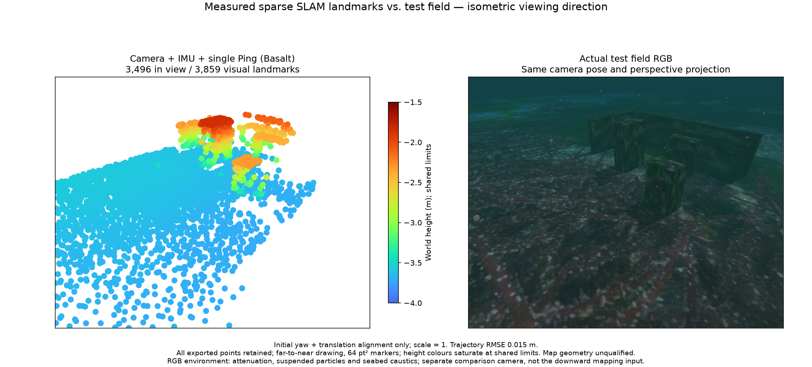
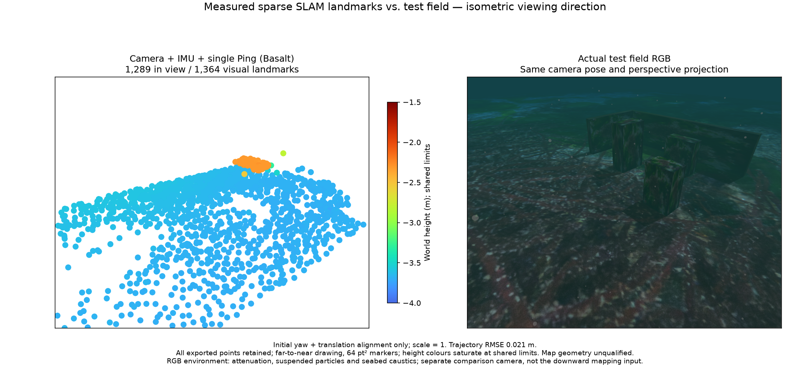
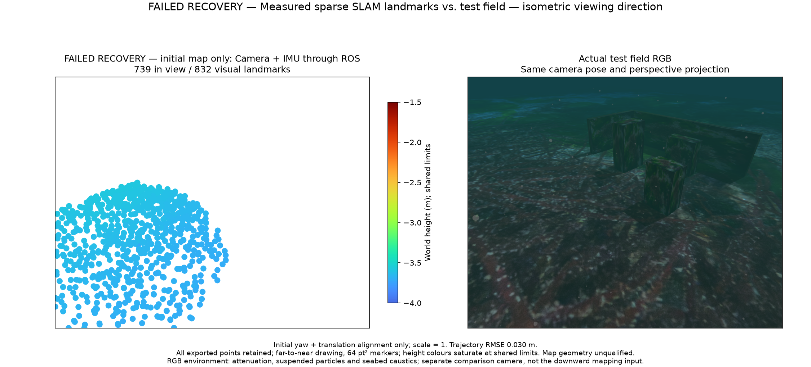

# Robust moving VIO startup and IMU-loss recovery

The actual ROS camera/raw-IMU/single-Ping owner initializes, exports a map,
clears the segment on IMU loss and exports a new map after input recovery.
Both 0.5× and 1× paced replays pass. Camera/IMU without Ping still fails map
recovery. This report does not qualify the installed app, navigation, sonar
mapping or all sensor combinations.

The unweighted startup seed at 73.6 s gives forward velocity 0.2060 m/s. Merely
fixing gravity magnitude gives 0.2076 m/s and does not solve the failure. The
new bounded track consensus gives 0.7949 m/s, using 45 of 112 multi-view tracks.
It uses calibrated pixels and raw IMU, without truth or previous VIO poses.
RANSAC and known-gravity tangent refinement are established methods; this is
independent Apache-2.0 project code, with no VINS-Mono code or new dependency.
See [VINS-Mono section V-B-3](https://arxiv.org/pdf/1708.03852).

## Complete-map measurements

| ROS case / 구간 | Points / 전체 점 | Surface RMSE | P95 | P99 | >10 cm | Maximum | Trajectory RMSE |
|---|---:|---:|---:|---:|---:|---:|---:|
| Ping, 0.5× initial | 3,790 | 10.00 mm | 18.95 mm | 28.89 mm | 1 | 12.95 cm | 1.59 cm |
| Ping, 0.5× recovered | 1,378 | 6.47 mm | 10.61 mm | 17.87 mm | 1 | 11.64 cm | 2.40 cm |
| Ping, 1× initial | 3,859 | 12.66 mm | 15.06 mm | 28.40 mm | 6 | 46.91 cm | 1.52 cm |
| Ping, 1× recovered | 1,364 | 6.13 mm | 10.93 mm | 21.15 mm | 0 | 4.96 cm | 2.08 cm |
| No Ping, initial only; recovery failed | 832 | 8.77 mm | 15.54 mm | 22.38 mm | 0 | 6.47 cm | 3.05 cm |

All vertices remain in the PLYs and assessments. These are nearest distances to
recorded static collision triangles, with initial yaw/translation alignment and
scale fixed at one. Quantiles use nearest rank. These statistics do not identify
physical feature correspondences, certify hydrography or measure area coverage.
The initial Ping maps have points near all three boxes and both walls. The
recovered segment observes a smaller part of the field. The camera/IMU-only
initial map has nearby points only on the seabed and does not reconstruct the
test objects, despite its low surface error.

The [6,213-point review](../map-accuracy-review-20261028/README.md) remains
accepted for its recorded-demo geometry. A zero-exceedance rule is not imposed
on these new records. The 1× initial map's six errors, including 46.91 cm, are
disclosed rather than removed; lifecycle success does not establish obstacle
recognition or navigation suitability. The native 0.1 m predicted three-sigma
admission budget and observation noise are unchanged.

Both figures use the same elevated camera, perspective projection, metre extent
and shared Turbo range −4 to −1.5 m. Every exported point enters the projection;
counts distinguish visible and total points. Markers are 64 pt², four times the
baseline diameter. RGB includes attenuation, suspended particles and seabed
caustics. It is a separate scene-reference camera; the estimator uses the
vehicle's downward camera. The recovered segment is not merged with the initial
map and cannot show objects observed only before the outage.

## Runtime and library evidence

The original camera/IMU/Ping recovery with an unweighted seed produces 530 new
visual poses but no admitted map. With consensus, both paced replays export new
segments; their receipts bind actual ROS domains, raw-input hashes, native
acknowledgements and frozen source files. Intentional IMU loss is the only
reset. All workers and transport threads stop after each check.

Camera/IMU without Ping produces 549 recovered visual poses and zero admitted
points in the retained 60-second interval. Its export fails and it cannot
register a provider. Do not hide this by loosening map information or by showing
the initial map as recovered. Next work must improve joint startup/recovery
information and bias handling under the actual motion, while retaining the
camera-only requirement.

A native map-information query failure with zero qualified entries is reported
as unavailable quality, withholding readiness while independently valid tracking
continues. Malformed or contradictory reports still fail. A protocol-only
injection withholds one status and then observes 211 ready statuses on the same
worker and segment, with no reset. It changes no optimizer or sensor input and
is not an estimator-accuracy qualification.

The native binary and all 43 bound native-source files match the fresh build
receipt. Processing requests and native frontend acknowledgements are bound to
each profile; no default processing budget changes. These experiments use
800×600 source images, the patch frontend, 10 Hz and a 512-cell hint. The app
defaults remain 120,000 pixels, 200 cells and 1,000 displayed points, with
2,000/5,000/full choices. No provider or installed SDK is activated by this
report.

Independent Python tests run 430 cases, with 16 optional native skips. The wheel
is installed at a different path containing a space; eight startup tests pass
under isolated Python, with no ROS/application imports. Eight affected app
scripts and both public-document audits pass. EN/KO documentation is generated
and reviewed at desktop and 390-pixel mobile widths.

Run `python summarize.py` to reproduce [summary.json](summary.json) using the
compressed every-point assessments. [build-and-source.json](build-and-source.json)
and [wheel-integrity.json](wheel-integrity.json) retain source/binary identities.
The bundle permits numerical review, not a full field rerun: original raw
recordings, native binary, SDK and the private application's ROS harness are
reused locally and not copied into this public library. The independent
library's synthetic tests run without that application.

## 한국어

카메라·원본 IMU·단일 Ping의 실제 ROS 관리자가 초기화·전체 지도 내보내기,
IMU 유실 시 구간 삭제, 복구 후 새 지도 내보내기를 0.5배속과 1배속에서
통과했습니다. 초기 특징점 중 일부의 추적 오차가 선형 초기 속도를 흔들었고,
중력 크기만 보정하는 방법은 해결하지 못했습니다. 여러 시점에서 일치하는
특징점을 RANSAC으로 선택하고 중력 크기를 유지하는 접평면 보정을 적용하면
복구 구간의 전방 속도 초기값이 0.2060m/s에서 0.7949m/s로 바뀝니다.
112개 중 45개 특징점을 사용하며 정답 자세나 이전 VIO 결과를 입력하지
않습니다. 기존 방법을 독립 구현한 공학적 개선이며 신규 알고리즘 주장은
아닙니다. VINS-Mono 구현 코드나 별도 의존성을 포함하지 않습니다.

위 표는 모든 점의 오차입니다. 기존 6,213점 기록의 기하 합격 판정은
유지하며 새 결과에도 오차 초과점 0개를 강요하지 않습니다. 1배속 초기
지도에는 10cm 초과점 6개와 최대 46.91cm 오차가 있어 그대로 보고합니다.
복구 지도는 1,364점·표면 RMSE 6.13mm·최대 4.96cm입니다. 이는 장애물
인식률이나 측량·항법 합격을 뜻하지 않습니다. 원래 점, 잡음과 지도 채택
불확실성 기준은 유지합니다.

그림은 같은 등각 방향의 카메라·원근 투영·미터 범위와 −4~−1.5m Turbo
높이 범위를 사용합니다. 전체 점을 투영하며 화면 안 점과 전체 점 수를
구분합니다. 점 지름은 기준의 4배입니다. RGB에는 수중 감쇠·부유 입자·해저
집광무늬가 적용돼 있습니다. 별도 비교 카메라의 영상이며 실제 추정 입력은
차량의 하향 카메라입니다. 복구 후 새 구간을 이전 지도와 합치지 않으므로
이전에만 관측한 물체는 나타나지 않습니다.

Ping 없는 카메라·IMU는 초기 지도 832점이 해저에만 있고, 복구 후 549개
시각 자세를 출력하지만 60초 동안 지도 점을 채택하지 못했습니다. 내보내기와
공급자 등록을 통과하지 못하며, 초기 지도를 복구 결과로 표시하지 않습니다.
이 조합의 공동 초기화 정보와 바이어스 처리가 다음 검증 대상입니다.

지도 정보 계산 실패는 품질 정보 대기 상태로 보고하며 유효한 추적을 그
이유만으로 재시작하지 않습니다. 모순되거나 잘못된 응답은 계속 거부합니다.
진단용 응답 주입 시험에서는 한 번 준비 상태를 보류한 뒤 같은 작업자·구간에서
준비 상태 211개를 확인했습니다. 추정기 정확도 검증과 별개입니다.

라이브러리 검사 430개 중 선택형 네이티브 검사 16개는 건너뛰었고 나머지는
통과했습니다. 다른 경로에 설치한 wheel은 격리 Python에서 초기값 검사 8개를
통과하며 ROS나 앱 모듈을 가져오지 않습니다. 앱 검사 8개와 문서 검사 2개가
통과했고 영문·한국어 페이지의 데스크톱·모바일 표시를 확인했습니다. 설치형
앱·전체 센서 조합·음향 지도·항법 합격은 아직 남아 있습니다.
