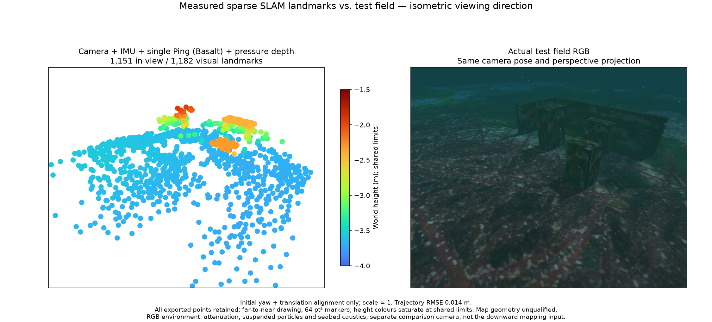
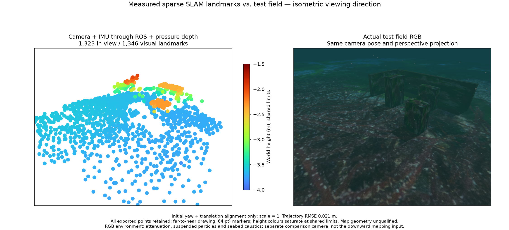
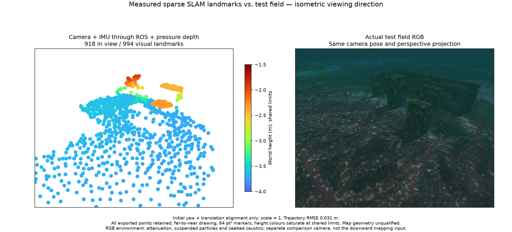

# Measured startup scoring and cold-start controls

The live owner performs a bounded camera/raw-IMU initializer before the native visual/inertial estimator starts. A resumed baseline field completes its physical survey and exports a complete 2,364-point map without a reset, but one serialized owner tick takes 1.71 s. Profiling a retained sensor window identifies repeated scalar RANSAC track scoring as substantial startup work. This field is a lifecycle/computation observation; its map is not a separately assessed accuracy result.

POSIM-SLAM candidate `ddaef839c504bab44b2519d646165e0103744908` groups tracks by observation count and evaluates each equal-length group with NumPy arrays. It adds no padding and preserves the original observations, timestamp order, front-facing check, per-track median reprojection, scoring order, 256 sampled hypotheses, fixed generator, refit steps, pixel noise and thresholds. Raw-IMU integration and native factor/map-admission rules are unchanged. This is a computation optimization, without a new SLAM-method or observability claim.

## Portable numerical control

[The fixture](fixture.json.gz) contains two measured feature/raw-IMU windows, their explicit calibration and source hashes. It contains no ideal poses, depths, map coordinates or private application code. [The scalar reference](scalar_reference.py) is POSIM-SLAM Apache-2.0 source from `65b3122`, preserved for this control. [The measured benchmark](benchmark.json) alternates scalar and batched execution on the same inputs.

| Measured window | Scalar median | Batched median | Maximum numerical difference |
| --- | ---: | ---: | ---: |
| Recovery window | 0.536 s | 0.197 s | 0 |
| Early covered window | 0.818 s | 0.222 s | 0 |

All returned seed values and inlier/outlier decisions agree in these controls. Thirteen affected seed/gravity tests pass, including mixed track lengths, points behind the camera, moving outliers, explicit calibration and unobservable motion. Timings describe this machine/load, not a hardware deadline or a cross-platform guarantee.

From the repository root, with NumPy available:

```sh
python3 docs/validation/seed-scoring-20261028/reproduce.py --output /tmp/seed-benchmark.json
```

The reproducer selects `libraries/posim-slam` in WWW-POSIM or the independent library's own `src` directory. `--component` explicitly selects another POSIM-SLAM checkout. Every run evaluates the full selected track set and checks the numerical result at tolerance 1e-10. No noise, sampling or accuracy limit is relaxed.

## Integration checkpoint

Three fresh source-bound ROS profiles run at original time, lose pressure, reject the stale map/export and recover in a new frame. Each has only the deliberately injected `pressure_stale` reset. All native threads and diagnostic writers stop; no received input is rejected for capacity. The native binary remains SHA-256 `cb5cbc7c254b668ea0b0e3c7ac0f2fe8dac0d4f07810bab2e8d3237ca18d1d87`.

| Input profile | Initial / recovered points | Surface RMSE, cm | Maximum, cm | Points above 10 cm |
| --- | ---: | ---: | ---: | ---: |
| Single-Ping distances fused | 1,182 / 1,142 | 1.68 / 1.31 | 22.63 / 14.67 | 5 / 3 |
| Ping received without fusion | 1,346 / 994 | 1.94 / 1.73 | 17.03 / 14.58 | 3 / 2 |
| No Ping input | 1,346 / 994 | 1.94 / 1.73 | 17.03 / 14.58 | 3 / 2 |

Every emitted vertex remains in the PLY and nearest-surface assessment. Geometry is evaluated afterward, with initial yaw/translation alignment and scale 1. No truth prior or point trimming enters estimation. Point counts can differ between live replay runs because worker readiness and startup handoff are asynchronous; the portable controls above hold the seed inputs fixed. Omitting Ping input does not establish physical payload absence.

The matched isometric RGB/full-cloud figures use all points, a shared −4 to −1.5 m Turbo height range and 64 pt² markers. The RGB overview is distinct from the estimator's mounted downward camera. Its caption identifies attenuation, particles and seabed caustics.

- Single Ping: [receipt](joint-ping/receipt.json.gz), [initial PLY](joint-ping/initial/map.ply), [recovered PLY](joint-ping/recovered/map.ply).




- Reception only: [receipt](receive-only-ping/receipt.json.gz), [initial PLY](receive-only-ping/initial/map.ply), [recovered PLY](receive-only-ping/recovered/map.ply).




- No Ping input: [receipt](no-ping/receipt.json.gz), [initial PLY](no-ping/initial/map.ply), [recovered PLY](no-ping/recovered/map.ply).




Run `python3 summarize.py` from any directory to check hashes, all six complete maps, all 7,004 per-vertex assessments, input/source consistency, recovery and shutdown. `reproduce.py` additionally reruns the numerical seed control with NumPy.

## Physical cold-start boundary

The [baseline](baseline.json) completes its checked survey with a [2,364-point full export](baseline-map.ply), maximum serialized tick 1,711 ms and peak ingress 239 messages. A fresh candidate [cold-03](cold-03/trial-result.json) completes the two-cycle, two-depth survey with [2,311 points](cold-03/map.ply), maximum tick 378 ms, peak ingress 54 messages and no operating reset. Its final status records 89 optimized Ping states and 121 pressure states. [Normal shutdown](cold-03/lifecycle.json) leaves [all owned groups empty](cold-03/owned-process-check.json). These field exports have no separate every-point accuracy assessment.

A second [cold-04](cold-04/trial-result.json) completes the same survey with [2,341 points](cold-04/map.ply), maximum tick 363 ms, peak ingress 50 messages, 90 Ping/120 pressure states and no operating reset. The third cold start enters a [continuous trial](cold-05-long/trial-result.json), completes three surveys and then fails at waypoint 17 of survey four with `navigation_lost`. At that boundary the SLAM status reports 5,725 landmarks without an estimator reset and maximum tick 371 ms; the [last complete export](cold-05-long/last-complete-map.ply) contains 5,426 points from the third survey. The later 5,725-point live archive was not exported before shutdown. The [failed mission record](cold-05-long/failed-mission.json.gz) is retained. This approximately 7.5-minute result does not pass the proposed 20-minute system gate.

[Cold-02](cold-02/trial-result.json) measures a 354 ms maximum startup tick, but its mission request returns HTTP 409. The response body was not captured; [the incomplete classification](cold-02/harness-failure.json) makes no claim about the rejection reason. The completed rerun waits for connected, fresh navigation and no arming blocker before requesting the mission. Additional cold starts and long-running qualification remain open.

Accepted statuses and maps are frozen before explicit shutdown. A subsequent `image_stale` in the stopping session is not an operating fault of the completed cold-03 trial. The earlier long GUI backlog snapshot predates its stop file and remains an unresolved operating observation. Preserve this distinction when reviewing terminal files.

Successful message reception, optimized measurements, map usefulness, initialization uncertainty and installed-package acceptance remain distinct gates. Long-running input backlog, low-visibility/camera-free sonar, DVL and platform coverage remain in the completion plan.

센서 원본과 RANSAC 가설·판정 기준을 유지하면서 같은 관측 수의 트랙을 묶어 계산합니다. 보존된 두 구간의 초기값과 인라이어·이상점 판정은 같으며 계산 시간이 줄었습니다. 세 입력 조합은 원본 시계의 ROS 재생에서 수압 유실 후 새 지도와 내보내기를 복구했습니다. 여섯 지도와 7,004개의 점별 평가를 모두 보존합니다. 새 시뮬레이터 두 세션은 항해를 완료했으며, 연속 시험은 세 번째 항해 완료 후 네 번째에서 항법 유실로 중단됐습니다. 해당 시점의 SLAM 재시작은 없지만 20분 시스템 검증은 미완료입니다. 초기화 불확실성, 제어 계통과 설치형 앱은 별도로 확인합니다.

[Repository documentation](../../../README.md)
