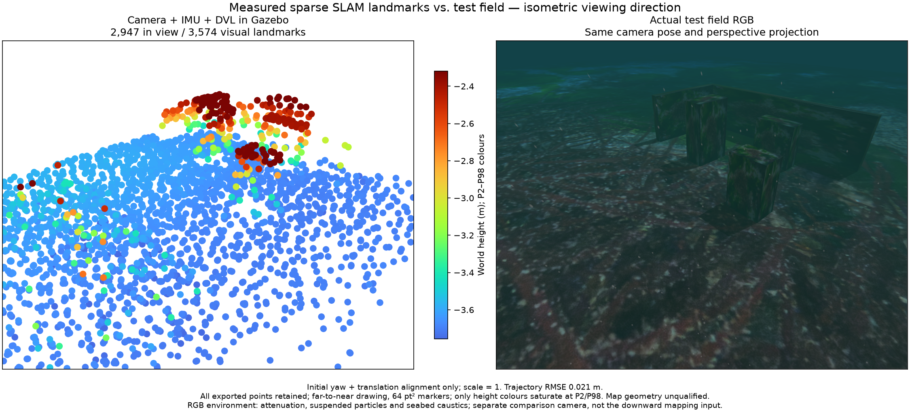
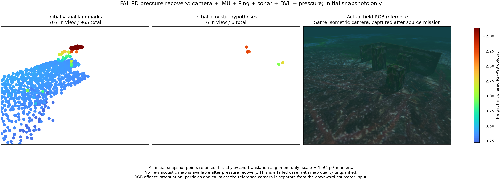

# Serialized estimation with independent ROS reception

2026-10-28. **Camera/IMU/DVL delivery and recovery pass the checks below. Map
quality, combined acoustic-map recovery and installed-app acceptance remain open.**

**카메라·IMU·DVL 전달과 복구는 아래 검사를 통과했습니다. 지도 품질·복합 음향 지도
복구·설치형 앱의 검증은 아직 완료되지 않았습니다.**

## Receiver boundary / 수신 경계

The WWW-POSIM host receives sensor messages on a separate ROS executor/thread.
It retains each original message and callback receipt time in a FIFO; one
serialized owner handles estimation, services and status files. The queue has
a 4,096-message and 64 MiB payload-estimate budget. Capacity failure is explicit;
old messages are not silently replaced. The existing 2 s freshness limits,
500 ms image-gap check and 20 ms IMU-gap check remain. Python/ROS overhead and
DDS buffers are additional to the queue payload budget.

The owner uses actual receipt time for liveness. Exact image/Ping pairing uses
the consumed receipt-time prefix while an already-received partner is queued,
so slow consumption does not prematurely expire that pair. A reset discards the
old queued context explicitly. Receiver shutdown precedes ROS-context teardown.
This Python thread shares process CPU/GIL resources; the tests do not establish
a hard real-time guarantee.

WWW-POSIM 수신 실행기는 원본 메시지와 콜백 수신 시각만 큐에 보존합니다. 추정·서비스·
상태 저장은 한 소유자가 순서대로 처리합니다. 큐 한도는 4,096개·추정 페이로드
64MiB이며 초과는 명시적 오류입니다. 기존 2초 신선도, 영상 500ms·IMU 20ms 간격
검사는 유지합니다. Python·ROS 객체와 DDS 버퍼는 이 페이로드 예산에 추가됩니다.

신선도는 실제 수신 시각으로 검사합니다. 이미 수신한 Ping이 큐에 남아 있으면 처리한
수신 시각 범위에서 영상/Ping 만료를 판단합니다. 초기화 때 이전 큐를 명시적으로
비우고 ROS 컨텍스트 종료 전에 수신 실행기를 닫습니다. 같은 프로세스의 CPU·GIL을
공유하므로 경성 실시간 동작을 검증한 것은 아닙니다.

## Deliberately stalled consumer / 소비자 지연 대조

Actual ROS publishes 50 full-resolution 800×600 RGB images at 10 Hz and
500 raw IMU messages at 100 Hz. A 1.05 s consumer sleep leaves the publisher
running. With the same DDS history depth of 5, the previous single-executor
image subscription loses **5 images**. The independent receiver preserves
**50/50 images and 500/500 IMU messages**, in order, with identical pixel hashes.
Peak queued payload estimate is **14,635,520 bytes**. This isolates the
consumer-stall loss mechanism; it does not attribute the original stall to a
particular filesystem call or certify every overload condition.

실제 ROS에서 800×600 RGB 영상 50장·원본 IMU 500개를 10Hz·100Hz로 발행하며
소비자만 1.05초 멈춥니다. 같은 DDS 큐 깊이 5에서 기존 구조는 영상 5장을 놓치고,
분리 수신은 영상 50/50장·IMU 500/500개를 순서와 픽셀 해시 그대로 보존합니다.
최대 큐 페이로드 추정값은 14,635,520바이트입니다. 지연 중 이력 손실을 분리한
시험이며 기존 지연의 특정 파일 호출 원인이나 모든 과부하 조건을 확정하지 않습니다.

## Native owner and field / 실제 소유자와 네이티브 월드

Measured ROS camera/IMU/DVL replay publishes 145 poses. A deliberate DVL
silence causes exactly one `dvl_stale` reset, clears the old map and rejects old
exports. Resumption creates a different frame with 32 poses and a 432-point
export, after the initial 935-point export. Startup export is rejected before
initialization. Native worker threads stop normally.

The requalified source/SDK/runtime descriptor runs the actual BlueROV turning
survey in an isolated macOS native development runtime. Its 120 s moving-input
observation keeps one segment after the intentional worker-recovery test and
publishes **600 poses**. The mission completes in **73.64 s**, with **1.327 m**
minimum observed body-centre clearance. Reception rejects zero messages; peak
queued payload is **1,474,816 bytes**. One queued packet is discarded at the
intentional initial reset. Exit is 0 without forced shutdown or owned processes
left behind. This is not an installed GUI or Windows/Linux runtime test.

Within the 18–138 s moving interval, saved status counters account for every
source-rate increment over the observed endpoints: 1,199 image intervals from
18.0 to 137.9 s at 10 Hz, and 11,989 IMU intervals from 18.07 to 137.96 s at
100 Hz. There are zero unaccounted increments between saved observations.
This counter check covers those endpoints; the deliberate reset is separate.

측정 ROS 재생에서 자세 145개를 발행합니다. DVL 중단에 따른 `dvl_stale` 초기화 한 번만
발생하며 이전 지도를 비우고 다운로드를 차단합니다. 재개 뒤 다른 좌표 구간에 자세
32개·지도 432점을 만들며 초기 지도는 935점입니다. 초기화 전 다운로드도 거부합니다.

실제 macOS 네이티브 개발용 BlueROV 실행은 의도한 작업자 복구 뒤 120초 동안 같은
구간을 유지하며 자세 600개를 발행합니다. 임무는 73.64초에 완료됐고 최소 기체 중심
여유는 1.327m입니다. 수신 거부는 0개, 최대 큐 페이로드는 1,474,816바이트입니다.
의도한 초기 재시작에서 대기 패킷 1개를 비웠습니다. 강제 종료나 잔류 소유 프로세스
없이 종료했으며 설치형 GUI나 Windows/Linux 실행을 검증한 것은 아닙니다.

18–138초 이동 구간의 저장 상태를 대조하면 영상 18.0–137.9초의 1,199개 간격과
IMU 18.07–137.96초의 11,989개 간격이 각각 10Hz·100Hz 수신 횟수와 일치합니다.
저장 관측 사이에서 설명되지 않는 증분은 0개입니다. 이 대조의 범위는 해당 시각
사이이며 의도한 초기 재시작은 별도로 기록합니다.

All 3,574 exported visual vertices enter projection; 2,947 lie in view. The
actual RGB reference uses identical camera perspective/bounds. Markers are
64 pt², far-to-near, with Turbo height colours. The RGB overview includes
attenuation, particles and caustics, and is separate from the downward input.
The display sample remains 1,000 and the full PLY contains 3,574 points.

The native information/culling research switches are off in this field test.
Trajectory RMSE is 2.06 cm; all-point p95 surface error is 9.56 cm and maximum
is 2.72 m, with 175 points beyond 10 cm. Truth geometry enters assessment only.
The map remains unqualified. The separately documented metric-map improvement
is not presented as enabled by this receiver change.

전체 3,574점을 투영하며 2,947점이 화면 안에 있습니다. 같은 원근·범위의 실제 RGB와
비교하고 먼 점부터 64 pt²·Turbo 높이 색으로 표시합니다. RGB에는 감쇠·입자·집광무늬가
있으며 하향 입력 카메라와 별개입니다. 뷰어 표본은 1,000점, 전체 PLY는 3,574점입니다.
이 실행에서는 연구용 공동 정보·저장점 재검사를 켜지 않았습니다. 궤적 RMSE는 2.06cm,
전체 표면 오차 95분위는 9.56cm, 최대는 2.72m이며 175점이 10cm를 넘습니다.
정답 지형은 평가에만 쓰며 지도 품질은 불합격입니다.

## Combined-sensor failure retained / 복합 센서 실패 보존

Camera + IMU + Ping + multibeam + DVL + pressure replay initially exports
965 visual points and 6 acoustic hypotheses. After deliberate pressure silence,
visual recovery exports 415 points, but no new acoustic map is available. The
complete recovery test **fails** with `sonar_map_unavailable`. The unchanged
legacy owner fails identically on the same interval, with the same pose stamps
and mean positions within 2.46e-12 m. The receiver has no queue rejection/fault.
This existing acoustic-map problem remains work to fix, and the combined mode
is not requalified by the delivery success.

카메라·IMU·단일 Ping·멀티빔·DVL·압력을 함께 재생하면 초기 시각 지도는 965점,
음향 가설은 6점입니다. 압력 중단 후 시각 지도 415점은 복구하지만 새 음향 지도는
없어 전체 시험이 `sonar_map_unavailable`로 **실패합니다**. 변경 전 소유자도 같은
시각·결과로 실패하며 평균 위치 차이는 2.46e-12m 이하입니다. 수신 큐 거부·오류는
없습니다. 이 음향 지도 문제는 계속 수정할 대상이며 복합 모드의 재검증을 통과시키지
않습니다.

This figure preserves every initial vertex: 767/965 visual and 6/6 acoustic
points lie in view. Both use one shared height scale and the same field RGB
projection. It depicts the initial snapshots of a failed run, before the outage.
The post-recovery acoustic map is unavailable; an empty map is not accepted.

실패 실행의 중단 전 초기 점을 모두 보존한 그림입니다. 시각 965점 중 767점과 음향
6점 모두가 화면 안에 있습니다. 같은 높이 색 범위·RGB 투영을 사용하며 복구 뒤의
음향 지도를 나타내지 않습니다. 빈 지도를 통과시키지 않습니다.

Fresh staging uses APFS clones, a current-source overlay and a separate
component snapshot without copying the SDK. Eight runtime-file fingerprints
include the receiver. Only the measured camera/IMU/DVL recovery profile is
registered; old descriptors are not relabelled. Bounded-queue unit controls,
exact image/Ping deadline controls, and relocated package import tests pass.

새 개발용 배치는 APFS 복제·현재 소스 덮어쓰기·별도 구성 요소 스냅샷을 사용하며 SDK를
다시 복사하지 않습니다. 수신 모듈을 포함한 런타임 파일 8개의 해시를 검증하고 실제로
통과한 카메라·IMU·DVL 프로필만 등록합니다. 큐 한도·영상/Ping 만료·다른 경로로
옮긴 패키지의 독립 가져오기 검사도 통과합니다.

- [ROS stall control](blocked-consumer.json)
- [DVL recovery](dvl-recovery.json)
- [Native field and complete-map statistics](native-summary.json)
- [Native measurement-clock and callback-count continuity](native-continuity.json)
- [Combined-sensor failed recovery](combined-failure.json)
- [Unchanged legacy owner control](legacy-combined-failure.json)
- [Old/new control comparison](combined-control-comparison.json)
- [Failed overview identity and alignment](failed-figure.json)
- [Source fingerprints and SDK identity](source-manifest.json)

[Live metric-map follow-up / 라이브 정밀도 검사 후속](../visual-live-map-information-20261028/README.md).
