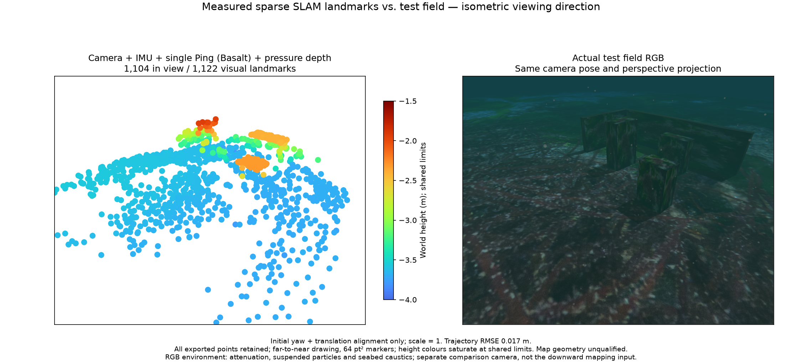
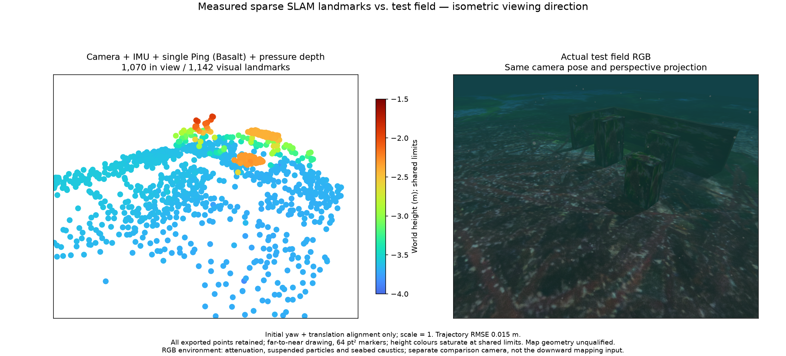
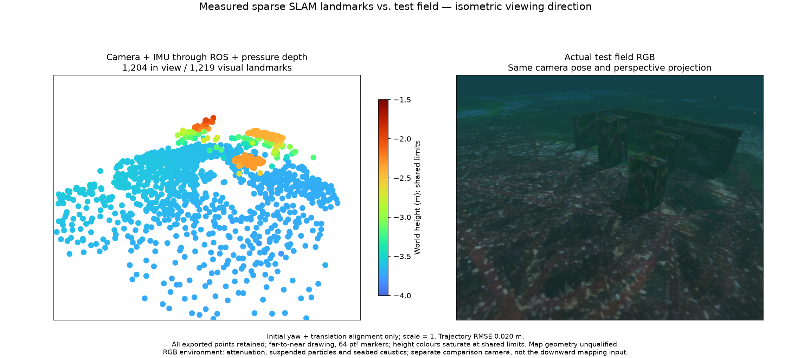
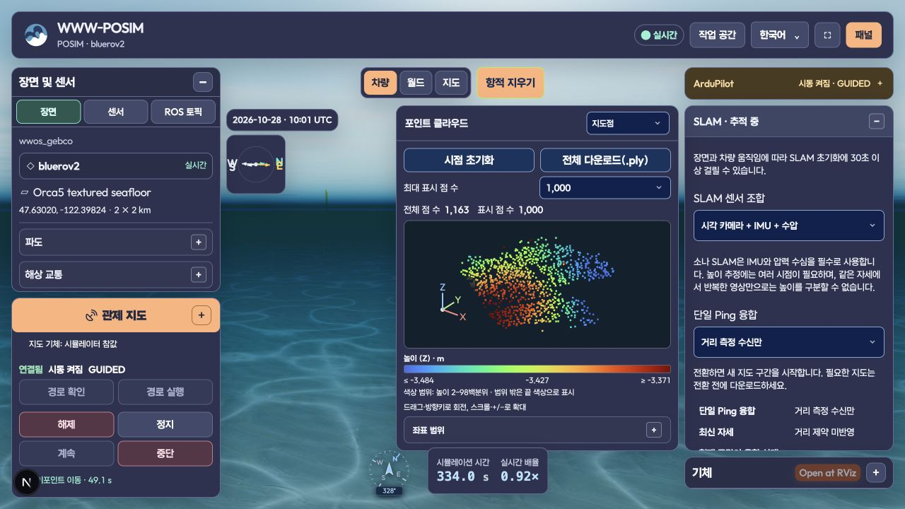

# Status publication and source-bound VIO input recovery

These measurements exercise the application ROS owner with POSIM-SLAM `1fdf5ab0a2342c2d7d5741996ebc8afd64ea6e6c` sources and the retained native binary SHA-256 `cb5cbc7c254b668ea0b0e3c7ac0f2fe8dac0d4f07810bab2e8d3237ca18d1d87`. They qualify this bounded input/recovery test, not general initialization, navigation or terrain reconstruction.

The native estimator, camera/IMU calibration, measurement noise, 120,000-pixel/200-cell/10 Hz budgets and 10 cm world-position three-sigma admission limit are unchanged. The application moves diagnostic status-file writes off the serialized sensor owner. One in-flight and one pending immutable status string are retained; only diagnostic snapshots coalesce. A completed temporary document atomically replaces the status file. A new segment discards transition inputs after worker teardown completes. Raw samples within a segment keep their ordering and timestamps.

All three actual ROS replays run at original time on the same measured record. Each uses camera, raw IMU and pressure, deliberately loses pressure, rejects the stale export and recovers in a new frame. The no-Ping profile omits the input; it does not establish that a custom physical model has no Ping sensor. Exact input, component and application-adapter hashes are retained in each compressed receipt. The source binding includes the shared status-file helper.

| Input profile | Points before / after recovery | Surface RMSE, cm | Points above 10 cm |
| --- | ---: | ---: | ---: |
| Single-Ping distances fused | 1,122 / 1,142 | 1.68 / 1.31 | 4 / 3 |
| Ping received without fusion | 1,219 / 994 | 1.72 / 1.73 | 3 / 2 |
| No Ping input | 1,219 / 994 | 1.72 / 1.73 | 3 / 2 |

The numbers are assessment-only nearest-surface distances after the recorded alignment. Every emitted point remains in its PLY and per-vertex assessment. No truth prior or point trimming enters estimation. These figures do not assert a map-quality improvement from a status-I/O change. The receive-only and absent-Ping profiles produce the same measured point coordinates in this trial.

## Matched field and cloud overviews

The RGB half is an independent isometric view of the field; the estimator uses its mounted downward camera. Both halves share the overview projection. The field uses native underwater environmental rendering, including suspended particles and seabed caustics. Comparison metadata records the cameras and alignment. All exported points are drawn, with the common height range and 64 pt² markers.

Single-Ping fusion — [receipt](joint-ping/receipt.json.gz), [initial PLY](joint-ping/initial/map.ply), [recovered PLY](joint-ping/recovered/map.ply):

Ping reception without fusion — [receipt](receive-only-ping/receipt.json.gz), [initial PLY](receive-only-ping/initial/map.ply), [recovered PLY](receive-only-ping/recovered/map.ply):

No Ping input — [receipt](no-ping-input/receipt.json.gz), [initial PLY](no-ping-input/initial/map.ply), [recovered PLY](no-ping-input/recovered/map.ply):

## Lifecycle and limits

Each replay has only the deliberately injected `pressure_stale` failure. The old map/export is rejected before the resumed segment. No received input is rejected for capacity, all native threads stop and the status-file writer joins with no pending document or write error. The longest background file writes in the three runs are 43.0, 31.7 and 20.9 ms. These durations are observations under the test load, not deadlines or throughput guarantees.

A separate deterministic test blocks file replacement while all submitted IMU samples are consumed, coalesces diagnostic updates and verifies that readers keep seeing the previous complete JSON. Failed replacement preserves that document and reports an explicit storage fault. Worker-teardown tests verify that a fresh segment starts after the transition rather than inheriting aged transition samples. Invalid replay intervals are checked before ROS ownership begins.

Actual GUI switches exercise the three source-bound profiles in a running BlueROV2 field. Before new maps exist, both observed switch directions clear the archive and reject export with HTTP 409. A receive-only segment exports 2,187 points with 1,142 Ping observations received, zero Ping-optimized states and 110 pressure-optimized states. After Ping is enabled again and additional multiview survey motion, segment 5 exports 2,513 points with 156 Ping-optimized and 784 pressure-optimized states. See [GUI summary](gui-summary.json) and its retained complete exports. The observation taken late during an earlier return already found a fresh map; it is not counted as an immediate-unavailability check.

Geometry admission after a restart is a separate gate: the returned segment initially withholds all points despite visual tracking and valid auxiliary fusion. Additional viewpoints recover the published map without changing noise or admission limits. One cold-start `sensor_ingress_stale` reset remains in this GUI session; no further input-fault reset occurs in the measured switch segments 2–5. A later continuation records `sensor_events_backlog` in segment 6; the terminal snapshot withholds its new map. The session therefore does not pass long-running stability. [Terminal status](gui-terminal-status.json.gz), [normal supervisor shutdown](gui-terminal-lifecycle.json) and [empty owned process groups](gui-terminal-processes.json) retain that outcome. Startup observability, broader long-running geometry, custom physical payloads, DVL/camera-free combinations and installed-platform qualification remain open. The live GUI owner has a bounded lease; the three ROS runs above have completed thread-shutdown proofs.

세 입력 조합 모두 원본 시간의 ROS 재생에서 수압 유실 후 새 구간으로 복구했습니다. 모든 지도점과 점별 평가를 보존하며, 수신만 하는 Ping은 최적화에 사용하지 않습니다. 실제 GUI에서도 전환 전 지도를 거부하고 새로운 지도를 생성했습니다. 재초기화 후에는 충분한 시점 변화가 필요했으며, 이 결과가 일반 지도 정확도나 설치형 앱의 검증 완료를 뜻하지는 않습니다.

Run `python3 summarize.py` from any directory to verify file hashes, all six complete PLYs, every-point coverage/statistics, equal input/source identities, pressure recovery and thread shutdown. It does not rerun the estimator or recreate the geometry oracle. No private application implementation is included in this evidence directory.

[Repository documentation](../../../README.md)
