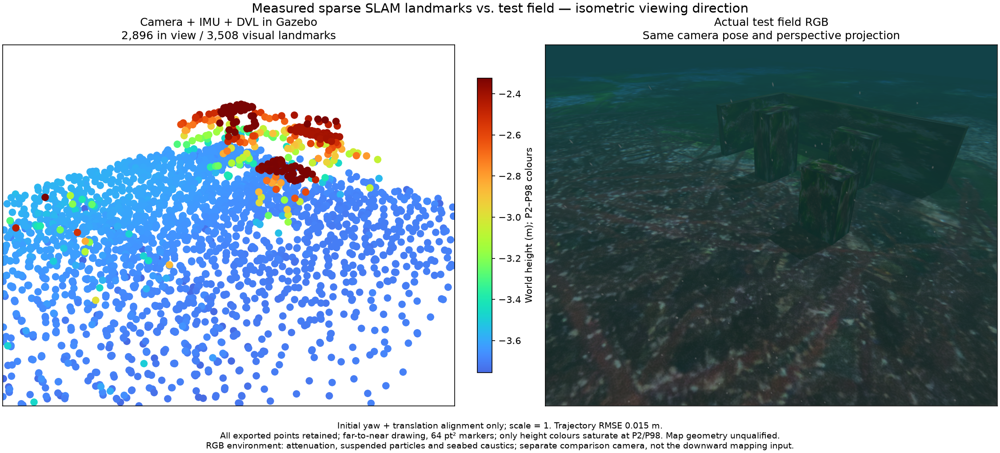

# Sparse archive information / 희소 지도 관측 정보

2026-10-27. Recorded camera + raw IMU + DVL. No mapping algorithm or
archive admission threshold changes in this experiment. **Map unqualified.**

카메라·원본 IMU·DVL을 사용한 기록입니다. 지도 알고리즘과 저장 기준을 바꾸지
않았습니다. **지도 품질은 아직 불합격입니다.**

Both views share the isometric camera direction, perspective and bounds. All
3,508 exported vertices enter projection; 2,896 lie in view. Points draw far to
near at 64 pt² with P2–P98 blue-to-red Turbo heights; only colours saturate.
RGB includes underwater attenuation, suspended particles and seabed caustics.
This separate comparison camera is not the onboard downward mapping input.

전체 3,508점을 투영하며 화면 안에는 2,896점이 있습니다. 같은 등각 방향·원근·범위를
사용하고 먼 점부터 64 pt²로 그립니다. 높이 2–98분위의 파랑→빨강 Turbo에서 색상만
포화시킵니다. RGB에는 수중 감쇠·부유 입자·해저 집광무늬가 있습니다. 비교 카메라는
기체의 하향 지도 입력과 별개입니다.

## Native run / 네이티브 실행

The 7 m × 4 m, three-lane survey completes in 74.56 simulated seconds. The
120-second observation keeps one segment after the deliberate recovery test.
Position RMSE is 1.50 cm; maximum position error is 2.33 cm. Minimum observed
swept body-centre clearance is 1.307 m. Exit is 0, with no forced shutdown or
remaining owned process. The unmodified native worker hash is recorded.

폭 4m·길이 7m의 세 줄 조사는 시뮬레이션 시간 74.56초에 완료됩니다. 의도적인
작업자 복구 시험 이후 120초 관측 동안 같은 지도 구간을 유지합니다. 위치 RMSE는
1.50cm, 최대 위치 오차는 2.33cm이며 최소 기체 중심 여유는 1.307m입니다.
강제 종료 없이 정상 종료했고 소유 프로세스가 남지 않았습니다.

This uses a development runtime with bounded packet-header diagnostics. It
omits the large raw camera archive used in the previous failed run. That run's
`worker:image_gap_or_reset` remains unresolved: this lower-capture-load success
neither proves its cause nor qualifies a fix. The first killed worker is an
intentional recovery test, not an unexpected reset. Installed-app and other
platform acceptance remain separate.

입력 헤더만 제한적으로 보관하는 개발용 실행이며, 앞선 실패 실행의 대용량 원본
카메라 저장은 생략합니다. 실행 부하가 다르므로 성공만으로 이전 시간 오류의
원인이나 해결을 입증하지 않습니다. 첫 작업자 종료는 의도적인 복구 시험입니다.
설치형 앱과 다른 운영체제의 검증은 별개입니다.

## Map error and conditioning / 지도 오차와 관측 기하

Every exported point is scored against physical collision boxes and seabed
triangles after estimation, with initial yaw/translation alignment and metric
scale fixed at 1. Median surface error is 1.36 cm, p95 is 6.74 cm, p99 is
35.89 cm and maximum is **2.83 m**. **131 / 3,508** vertices exceed 10 cm.
No truth geometry enters mapping or the information audit, and no point is
removed from the PLY or assessment.

모든 점을 추정 이후의 독립 물리 표면과 비교합니다. 초기 방위·평행이동만 정렬하고
척도는 1로 고정합니다. 표면 오차 중앙값은 1.36cm, 95분위는 6.74cm, 99분위는
35.89cm, 최대는 **2.83m**입니다. **131/3,508점**이 10cm를 넘습니다. 정답 지형은
추정기나 관측 정보 계산에 입력하지 않으며 점을 제거하지 않습니다.

`audit_visual_archive.py` checks the exact exported IDs/float32 coordinates,
request and timestamp before projecting the final archive into recorded
full-weight observations. It uses the historical published estimated poses,
calibrated resize convention and an explicit **0.5 px** independent-noise
assumption matching the native development configuration. Pixel Jacobians and
SVD report the largest conditional position standard deviation. Identical
views provide no finite depth information, irrespective of observation count.

진단 도구는 내보낸 ID·float32 좌표·요청·시각을 확인한 뒤 마지막 지도점을 기록된
유효 관측으로 재투영합니다. 기록된 추정 자세를 고정하고 개발 설정과 같은
**0.5픽셀** 독립 잡음 가정을 사용합니다. 픽셀 자코비안과 SVD로 조건부 위치
표준편차를 구합니다. 같은 위치에서 여러 번 관측해도 깊이 정보가 생기지 않습니다.

| Diagnostic / 진단 | Within 10 cm / 10cm 이내 | Outside 10 cm / 10cm 초과 |
| --- | ---: | ---: |
| Vertices / 점 | 3,377 | 131 |
| Median camera baseline / 촬영 기선 중앙값 | 1.195 m | 0.160 m |
| Median conditional position sigma / 조건부 위치 표준편차 중앙값 | 0.0138 m | 0.1119 m |
| Median observed duration / 관측 기간 중앙값 | 3.2 s | 6.2 s |
| Median exposures / 관측 횟수 중앙값 | 17 | 32 |

Longer tracking alone does not establish a well-conditioned static point.
The largest-error point has a 6.9 cm camera baseline across seven observations.
The current positive-three-sigma inverse-range admission test establishes a
conditional depth-sign test, not a metric map-error bound. Joint pose and
calibration uncertainty, changing correspondences and correlations remain
unmodelled here. Historical poses also differ from retrospectively optimized
window poses. The audit is diagnostic: no sigma cutoff, static-point certificate
or map-quality improvement is claimed. It does not identify particles or any
other particular visual effect as the cause.

오래 추적했다는 사실만으로 안정적인 고정점이 되지 않습니다. 최대 오차점은 7번
관측됐지만 촬영 기선이 6.9cm입니다. 현재 양의 3시그마 역거리 조건은 깊이 부호에
대한 조건부 검사이며 절대 지도 오차의 상한이 아닙니다. 결합 자세·보정 불확실도,
대응 변화와 상관은 이 계산에 포함하지 않습니다. 기록된 과거 자세와 창 내에서
다시 최적화된 자세도 구분해야 합니다. 이 진단으로 임의 표준편차 기준을 적용하거나
입자를 오류 원인으로 단정하지 않으며 지도 개선·고정점 인증을 주장하지 않습니다.

Six independent controls cover analytic stereo variance, degenerate repeated
views, noise scaling, rigid-frame invariance, inconsistent/behind-camera
observations and exact map/frame identity. Compressed arrays preserve every
vertex's diagnostic and independent surface error. Full trace/raw run files
remain on the external development disk; hashes are recorded here. These are
standard projection/information calculations, not a research novelty claim.

해석 가능한 스테레오 분산, 같은 위치의 퇴화 관측, 잡음 배율, 좌표계 불변성,
불일치·후방 관측, 지도·프레임 일치를 여섯 검증으로 확인합니다. 모든 점의 진단값과
독립 표면 오차는 압축 배열로 보존하며 전체 기록은 외장 개발 디스크에 유지합니다.
이는 기존 투영·정보 계산을 적용한 진단으로 연구 독창성을 주장하지 않습니다.
