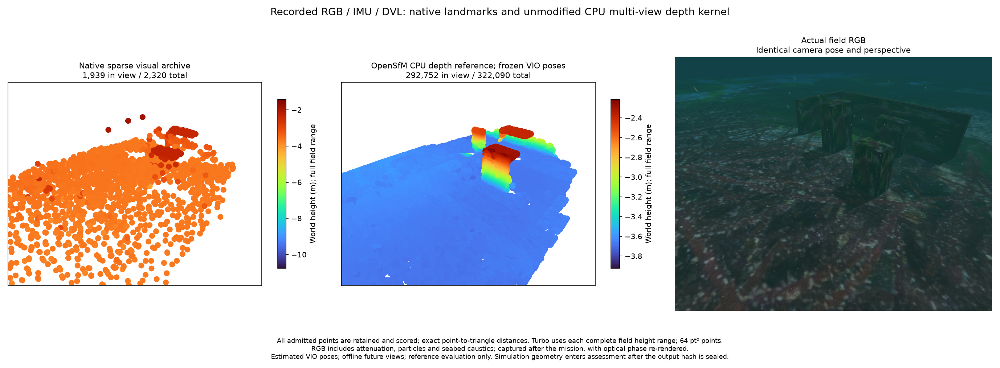
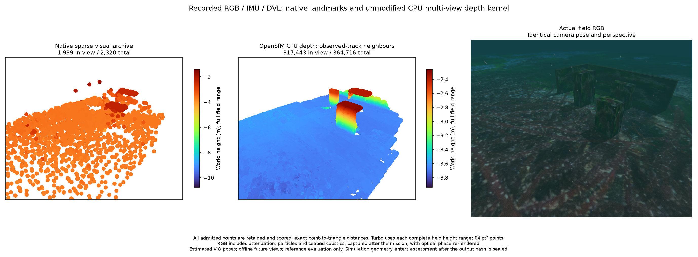
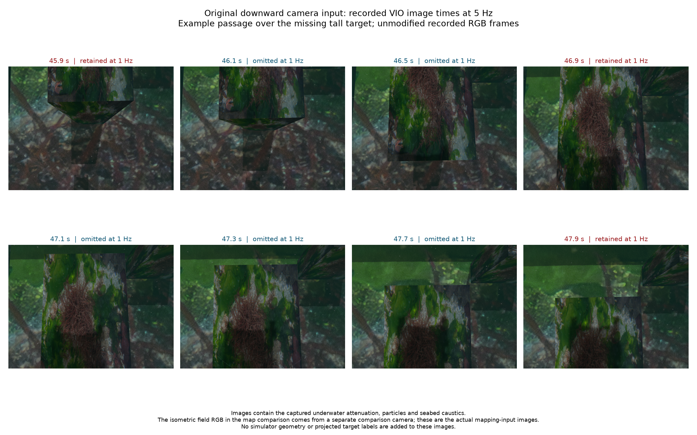
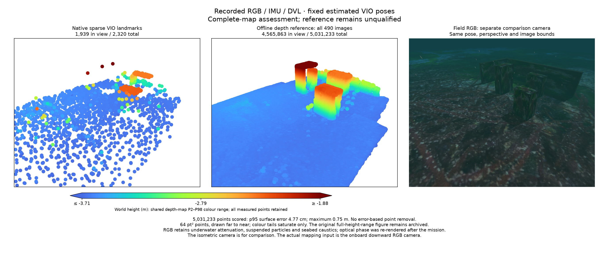

# CPU 다중 시점 깊이 복원 기준실험 / CPU multiview depth reference

2026-10-27. Recorded RGB / IMU / DVL input and fixed estimated VIO camera poses.
The unmodified Mapillary OpenSfM CPU depth kernel produces this **offline
reference**. Runtime integration and complete-map qualification remain open.

기록한 RGB·IMU·DVL 입력과 추정 VIO 카메라 자세를 사용한 **오프라인 기준실험**입니다.
Mapillary OpenSfM의 CPU 깊이 복원 커널을 수정 없이 사용합니다. 실시간 앱 통합과
완전한 지도 검증은 아직 완료되지 않았습니다.

Left: archived sparse landmarks. Centre: CPU multiview depth reference. Right:
actual field RGB at the same camera pose. Underwater attenuation, suspended
particles and seabed caustics are visible. All admitted points are scored; the
figure projects them into the shared camera view with 64 pt² markers. Each cloud
uses its complete height range for Turbo colours.

왼쪽은 기존 희소점, 가운데는 CPU 다중 시점 복원, 오른쪽은 동일 시점의 실제 RGB입니다.
수중 감쇠·부유 입자·해저 집광무늬를 포함합니다. 모든 생성점을 평가하며, 비교 그림은
동일 카메라 범위에 투영합니다. 점 크기는 64 pt², Turbo 범위는 각 점군 전체 높이입니다.

| Measurement / 측정 | Sparse / 희소점 | Depth reference / 깊이 복원 |
| --- | ---: | ---: |
| Exported points / 내보낸 점 | 2,320 | 322,090 |
| 90th-percentile surface error / 표면 오차 90분위 | 6.19 cm | 3.13 cm |
| Maximum surface error / 최대 표면 오차 | 7.02 m | 23.01 cm |
| Points within 10 cm / 10 cm 이내 점 | 2,176 | 320,382 |

The reference median is 1.33 cm and its 95th percentile is 3.87 cm. Exact
point-to-triangle distances use the physical boxes and seabed only after sealing
the output hash. The independent accelerated evaluator agrees with the existing
Python evaluator within 1.8e-15 m on random and analytic controls.

기준 복원의 중앙값은 1.33 cm, 95분위는 3.87 cm입니다. 출력 해시를 확정한 뒤에만
물체 충돌면과 해저를 이용해 정확한 점–삼각형 거리를 계산합니다. 가속 평가기는
독립 Python 평가기 및 해석적 제어 사례와 일치합니다.

Point count and aggregate error do not establish completeness. On a 5 cm model
face grid, top-face coverage within 5 cm changes as follows. This descriptive
metric includes all model faces; visibility and association are not inferred.

점 수와 전체 오차만으로 완성도를 판정하지 않습니다. 물체 상부를 5 cm 격자로 표본화해
복원점과의 거리가 5 cm 이내인 비율을 비교합니다. 모든 면을 대상으로 하는 기술적
지표이며 가시성이나 물체 대응을 판정하는 값은 아닙니다.

| Top face / 상부 | Sparse / 희소점 | Depth reference / 깊이 복원 |
| --- | ---: | ---: |
| Target 0 | 59.3% | 74.5% |
| Target 1 | 1.5% | **0.0%** |
| Target 2 | 57.9% | 100.0% |

Wall 1 is also almost absent. **The complete map is not qualified.** The retained
baseline-only neighbour graph is compared with image covisibility below. No
threshold was relaxed or scene-based point filtering used to qualify this result.

벽 1도 거의 복원되지 않았으므로 **완전한 지도 합격으로 인정하지 않습니다.**
아래 추가 실험에서 거리 기반 인접 뷰 선정과 실제 공통 영상 특징을 이용한
선정을 비교합니다. 합격을 위해 임계값을 완화하거나 장면 기반 점 제거를 하지 않았습니다.

The run computes 98 depthmaps, cleans by cross-view consistency, and prunes/merges
16 reference views. Processing takes 464.3 s with 337.4 MiB maximum RSS on Apple
Silicon macOS. It uses the existing SDK; full RGB records and depthmaps remain
local. [Settings and summary](summary.json), [face coverage](surface-coverage.json),
[complete PLY](map.ply), and [analytic controls](analytic-controls.json) are retained.

98개 깊이맵을 계산한 뒤 시점 간 일관성 검사와 중복 제거를 적용해 기준 16시점을 합칩니다.
Apple Silicon macOS에서 464.3초, 최대 RSS 337.4 MiB를 측정했습니다. 기존 SDK를
재사용하며 원시 RGB와 깊이맵은 로컬에 보존합니다. 전체 점군과 요약은 위 파일에 있습니다.

Kernel: [Mapillary OpenSfM 65571c8](https://github.com/mapillary/OpenSfM/tree/65571c8ae9ac6a1d0bcd3fdc1ea5fff97b1b5611),
BSD-2-Clause; [retained notice](opensfm-license.txt). OpenCV core/imgproc 4.13.0
comes from the existing SDK. These are conventional photometric depth estimation
and geometric consistency methods, not a new research-method claim.

Scene/texture: [Orca5 5f7cdc1](https://github.com/clydemcqueen/orca5/tree/5f7cdc1f044926ebd56f2ce8a1fc4a82990cfa5e),
MIT; [retained notice](orca5-license.txt). 장면·텍스처의 Orca5 MIT 고지를 보존합니다.
이 실험은 기존 광도 기반 깊이 추정과 기하 일관성 방법의 기준 검증이며 신규 학술 방법을 주장하지 않습니다.

## Observed-track neighbours / 관측 특징 기반 인접 뷰

Only the neighbour graph changes. The published OpenSfM rule ranks views sharing
more than 20 observed VIO tracks with estimated-point parallax between 3° and 30°;
at most seven matching views enter the same depth kernel. Images, estimated poses,
16 reference views and depth/consistency thresholds stay fixed. No simulator
geometry enters view selection or reconstruction.

인접 뷰 선정만 변경했습니다. OpenSfM의 기존 규칙에 따라 추정 점의 시차가
3°–30°이고 공통 VIO 관측 특징이 20개를 초과하는 뷰를 점수순으로 최대 7개
선택합니다. 영상·추정 자세·기준 16시점·깊이 및 일관성 임계값은 동일합니다.
시뮬레이터 형상은 뷰 선정과 복원에 사용하지 않습니다.

The result retains and scores all **364,716 points**: median error 1.31 cm,
90th percentile 3.02 cm, 95th percentile 3.56 cm, maximum 52.98 cm, and 364,636
points within 10 cm. Target 0 top-face coverage within 5 cm increases from 74.5%
to 91.7%; target 2 remains 100%. Target 1 top-face coverage stays **0%**, and wall
1 has no points within 10 cm. **The complete map still fails qualification.**
Better neighbours alone do not resolve the missing surfaces; their input-view
visibility and texture observability require inspection before further changes.

전체 **364,716점**을 보존하고 평가했습니다. 오차 중앙값 1.31 cm, 90분위
3.02 cm, 95분위 3.56 cm, 최대 52.98 cm이며 364,636점이 10 cm 이내입니다.
물체 0 상부의 5 cm 이내 복원 비율은 74.5%에서 91.7%로 증가하고 물체 2는
100%를 유지합니다. 물체 1 상부는 여전히 **0%**이며 벽 1은 10 cm 이내 점이
없습니다. **완전한 지도는 계속 불합격입니다.** 인접 뷰 선정만으로 누락 면을
해결하지 못했으므로 추가 변경 전에 입력 영상의 가시성과 텍스처 관측성을 확인합니다.

Processing takes 461.0 s and 388.3 MiB maximum RSS. The same-camera figure uses
64 pt² markers and full-field Turbo height ranges, with underwater attenuation,
particles and seabed caustics in RGB. [Summary](covisibility-summary.json),
[face coverage](covisibility-surface-coverage.json) and
[complete PLY](covisibility-map.ply) preserve this separate experiment.

처리 시간은 461.0초, 최대 RSS는 388.3 MiB입니다. 동일 카메라 비교 그림은
64 pt² 점과 전체 높이 범위의 Turbo 색상을 사용합니다. RGB에는 수중 감쇠·입자·
해저 집광무늬가 포함됩니다. 이 추가 실험의 요약·면별 복원 비율·전체 PLY를
별도 파일로 보존합니다. 실시간 통합과 설치형 앱 검증은 아직 완료되지 않았습니다.

## Input coverage audit / 입력 영상의 관측 범위

These are original onboard downward-camera inputs. The isometric field RGB in
the map comparisons comes from a separate comparison camera at the point-cloud
plot's viewpoint. It is not the onboard image used to reconstruct the map.
The frames preserve captured attenuation, particles and seabed caustics.

위 그림은 실제 하향 카메라의 원본 입력입니다. 점군 비교의 등각 방향 RGB는
점군 그림과 같은 시점에 배치한 별도의 비교 카메라 영상입니다. 지도 복원에 쓴
기체 카메라 영상과 구분합니다. 기록한 감쇠·부유 입자·해저 집광무늬를 유지합니다.

Fusing all 98 computed depthmaps, instead of the selected 16, retains 1,082,618
points but still gives **0%** target 1 top-face coverage within 5 cm. All-point
p95 is 4.08 cm and the maximum is 1.43 m. More fusion views alone do not repair
the missing surface. [All-98-view summary](all-98-view-summary.json); the complete
raw fields and failed fusion remain local.

계산한 깊이맵 98개를 모두 합치면 1,082,618점이 남지만 물체 1 상부의 5 cm 이내
복원 비율은 여전히 **0%**입니다. 전체 점의 95분위 오차는 4.08 cm, 최대 오차는
1.43 m입니다. 합치는 시점 수만 늘려서는 누락 면을 해결하지 못합니다. 전체 원시
필드와 실패한 합성 결과는 로컬에 보존하며 위 요약에 모든 점의 평가를 기록합니다.

The [geometric support audit](input-support-summary.json) uses aligned estimated
cameras, a 5 cm face grid, frustum/front-face checks and authored-box occlusion.
It is an **upper bound**: seabed occlusion and successful pixel matching are not
established. For target 1's top, all grid samples can have at least three views
at the recorded VIO image times (490 frames, 5 Hz). After the fixed 1 Hz reduction
(98 frames), **none** can have three views. The full-rate selected graph also
permits three-view support across the top. The second wall's main inner face
has only 2.7% three-view support even at full rate; that requires better mission
coverage, rather than accepting its absence as successful reconstruction.

기하 검사는 정렬한 추정 카메라, 5 cm 면 격자, 시야각·앞면 검사와 시험 상자에
의한 가림을 사용합니다. 해저 가림과 픽셀 대응 성공을 확인하지 않은 **상한값**입니다.
물체 1 상부는 VIO 영상 시각 전체인 5 Hz·490프레임에서 모든 표본에 3시점 이상의
관측이 가능하지만, 1 Hz·98프레임으로 줄이면 그 조건을 만족하는 표본이 **없습니다**.
전체 주기에서 선택한 인접 뷰도 상부 전체의 3시점 관측을 허용합니다. 두 번째 벽의
주요 안쪽 면은 전체 주기에서도 2.7%만 3시점 지지를 가지므로 촬영 경로를 개선해야
합니다. 누락된 벽을 성공적인 복원으로 인정하지 않습니다.

POSIM-SLAM's independent
[`image_neighbors` utility](https://github.com/IOES-Lab/POSIM-SLAM/blob/main/docs/diagnostics/multiview-inputs.md)
implements the standard common-track/parallax rule while retaining all supplied
image IDs. Geometry controls, an isolated wheel import and exact agreement with
the frozen 490-image graph pass. [Recorded selector verification](selector-verification.json).
This does not qualify depth reconstruction or change the live app estimator.

POSIM-SLAM의 독립 `image_neighbors` 함수는 기존 공통 특징·시차 규칙을 구현하고
모든 입력 영상 ID를 보존합니다. 기하 제어 검사·격리 wheel 가져오기·고정된 실제
490영상 그래프와의 정확한 일치를 확인했습니다. 깊이 복원의 합격을 뜻하거나
실시간 앱 추정기를 변경하는 결과는 아닙니다.

## Full recorded image rate / 기록 영상 전체 주기

This offline reference uses all 490 pose-matched RGB images from 14.9–112.7 s
at 5 Hz. Recorded RGB / IMU / DVL provide fixed estimated VIO poses. The same
observed-track rule selects up to seven matching views; all computed reference
views enter pruning and fusion. The unmodified pinned depth kernel and explicit
0.1–100 m search range remain fixed. This is not the complete upstream OpenSfM
pipeline or its default configuration.

이 오프라인 기준실험은 14.9–112.7초의 5 Hz RGB 영상 490개를 모두 사용합니다.
기록된 RGB·IMU·DVL로 추정한 VIO 자세를 고정합니다. 기존 공통 특징 규칙으로
대응 뷰를 최대 7개 선택하고, 모든 기준 뷰를 중복 제거·합성에 사용합니다.
고정 리비전의 깊이 커널과 명시적인 0.1–100 m 탐색 범위는 유지합니다.
전체 OpenSfM 처리 흐름이나 기본 설정을 그대로 실행한 결과는 아닙니다.

- **5,023,301 points** retained and scored, with 5,019,716 within 10 cm of a
  physical surface. Median error is 1.59 cm, p90 4.00 cm, p95 4.77 cm and
  **maximum 29.75 m**.
- Target 0 / 1 / 2 top-face coverage within 5 cm is **100% / 100% / 100%** on
  the same 5 cm face grid. The second wall remains almost absent: its main inner
  face coverage is 2.08% within 5 cm.
- Processing takes **2,415.4 s**, with **1,823.1 MiB** maximum RSS. Median raw
  depth time is 4.82 s per image. This offline run is not a real-time app mode.

전체 **5,023,301점**을 보존·평가했으며 5,019,716점이 실제 표면의 10 cm
이내입니다. 중앙값은 1.59 cm, 90분위는 4.00 cm, 95분위는 4.77 cm이고
**최대 오차는 29.75 m**입니다. 동일한 5 cm 면 격자에서 세 물체 상부의
5 cm 이내 복원 비율은 모두 **100%**입니다. 두 번째 벽의 주요 안쪽 면은
2.08%만 복원됩니다. 처리 시간은 **2,415.4초**, 최대 RSS는 **1,823.1 MiB**이고
영상당 원시 깊이 계산 중앙값은 4.82초입니다. 실시간 앱 모드는 아닙니다.

**The complete map remains unqualified.** Preserving the recorded image rate
restores the missing roof in this case, but does not establish general map
accuracy or completeness. This comparison also changes the available view graph
and number of fused views; it is not an isolated frame-rate-only intervention.
All far outliers remain in the complete raw field and error statistics.

**완전한 지도는 계속 불합격입니다.** 이 기록에서는 영상 주기를 보존했을 때
누락된 상부를 복원했지만 지도 정확도와 완성도를 검증한 결과는 아닙니다.
사용 가능한 뷰 그래프와 합치는 뷰 수도 바뀌므로 영상 주기 하나만의 효과로
단정하지 않습니다. 멀리 잘못 생성된 점도 원시 필드와 모든 오차 통계에 남깁니다.

The figure projects every point inside the shared comparison-camera frustum:
1,939 / 2,320 sparse landmarks and 4,559,986 / 5,023,301 depth points. Points
are drawn far to near at 64 pt². Both clouds use the depth map's shared P2–P98
height limits, −3.71 to −1.88 m, with the viewer's blue-to-red Turbo entries.
Only colours saturate; measured bounds and point storage remain unchanged.
The [original full-height-range figure](full-rate-full-height-comparison.png)
preserves the −33.24 to −1.83 m dense range. RGB uses the same comparison camera
and includes attenuation, suspended particles and seabed caustics. The mapping
input is the separate onboard downward camera shown above.

비교 카메라 시야 안의 희소점 1,939/2,320개와 깊이점 4,559,986/5,023,301개를
모두 투영하고, 먼 점부터 64 pt²로 그립니다. 두 점군은 깊이 지도의 높이
2–98분위인 −3.71~−1.88 m와 뷰어의 파랑→빨강 Turbo 색상을 공유합니다.
색상만 포화시키며 측정 범위와 저장 점은 바꾸지 않습니다. 전체 높이를 쓰는
별도 그림에는 −33.24~−1.83 m 범위를 보존합니다. RGB는 같은 비교 카메라에서
촬영했고 감쇠·부유 입자·해저 집광무늬를 포함합니다. 복원 입력은 위에서 제시한
별도의 기체 하향 카메라입니다.

[All-point summary and raw-file hashes](full-rate-summary.json),
[complete face coverage](full-rate-surface-coverage.json),
[projection and colour metadata](full-rate-plot.json).
The 60,279,907-byte complete binary PLY, raw depthmaps and per-point assessment
remain in local experiment storage. The JSON records identify the complete
field and PLY by SHA-256; this documentation does not substitute a sampled cloud
for that output. Existing smaller experiment PLY files above remain available.

전체 이진 PLY 60,279,907바이트, 원시 깊이맵과 점별 평가는 로컬 실험 저장소에
보존합니다. JSON은 전체 필드와 PLY의 SHA-256을 기록합니다. 표본 점군을 전체
결과로 대신 제공하지 않으며, 위의 이전 소규모 실험 PLY도 유지합니다.

### Estimated-landmark depth bounds / 추정 랜드마크의 깊이 범위

The [depth-range audit](landmark-depth-range-audit.json) executes the exact pinned
upstream `compute_depth_range` function against the recorded estimated points:
camera-space depth P10 × 0.9 to P90 × 1.1. The near bound spans 1.005–3.225 m
across 490 images, and the far bound spans 2.699–4.198 m. The point set matches
the frozen view graph's last full-weight VIO estimate for each track ID.
Analytic percentile and explicit-override controls pass.

깊이 범위 검사는 고정된 원본 `compute_depth_range` 함수를 그대로 실행합니다.
카메라 좌표의 추정 점 깊이에서 10분위 × 0.9와 90분위 × 1.1을 사용합니다.
490영상의 가까운 경계는 1.005–3.225 m, 먼 경계는 2.699–4.198 m입니다.
뷰 그래프와 같은 트랙별 마지막 full-weight VIO 추정 점을 사용합니다.
해석적 분위수와 명시적 설정 우선순위 제어 검사를 통과했습니다.

The current 0.1–100 m run has 5,127,032 of 43,915,798 accepted raw depth pixels
outside those landmark bounds. Those pixels are not thereby classified as
incorrect: sparse landmark support can miss a real surface. The audit neither
filters the existing map nor proves a correction. Re-estimation with the
source-derived range requires its own complete-map assessment. No simulator
geometry or truth enters the bounds.

기존 0.1–100 m 실험의 수용된 원시 깊이 픽셀 43,915,798개 중 5,127,032개가
이 랜드마크 범위 밖에 있습니다. 희소 랜드마크가 실제 표면을 놓칠 수 있으므로
이를 곧바로 잘못된 점으로 분류하지 않습니다. 검사는 기존 지도를 자르거나
수정 효과를 증명하지 않습니다. 원래 규칙의 범위로 다시 추정한 결과도 전체
지도를 별도로 평가해야 합니다. 범위 계산에 시뮬레이터 형상·정답을 사용하지 않습니다.

## Re-estimation with landmark depth bounds / 랜드마크 깊이 범위로 재추정

The next reference uses the upstream P10 × 0.9 / P90 × 1.1 rule audited above.
It re-estimates all 490 raw depthmaps with the same recorded images, fixed VIO
poses, observed-track graph and consistency settings. It does not trim the old
point cloud using scene geometry. The pinned PatchMatch kernel has stochastic
initialization; these are individual runs, not a deterministic paired isolation
of the range setting.

위에서 확인한 원본의 10분위 × 0.9 / 90분위 × 1.1 규칙으로 깊이를 다시
추정합니다. 영상 490개·고정 VIO 자세·공통 특징 그래프·일관성 설정을 유지하고
원시 깊이맵 전체를 다시 계산합니다. 장면 형상으로 기존 점군을 자르지 않습니다.
커널의 초기화는 확률적이므로 각 실행의 비교이며, 깊이 설정의 영향만을
결정론적으로 분리한 실험은 아닙니다.

All **5,031,233 generated points** remain retained and scored. Median surface
error is 1.59 cm, p90 4.00 cm, p95 4.77 cm and maximum **75.43 cm**. All three
target roofs retain 100% coverage within 5 cm. Processing takes 2,452.6 s with
1,361.8 MiB maximum RSS; median raw-depth time is 4.88 s per image.

생성된 **5,031,233점 전체**를 보존·평가합니다. 표면 오차 중앙값은 1.59 cm,
90분위 4.00 cm, 95분위 4.77 cm, 최대 **75.43 cm**입니다. 세 물체 상부의
5 cm 이내 복원 비율은 모두 100%입니다. 처리 시간은 2,452.6초, 최대 RSS는
1,361.8 MiB이며 영상당 원시 깊이 계산 중앙값은 4.88초입니다.

The wide-range case's 29.75 m maximum is absent, while p95 remains practically
unchanged. There are **3,979 points beyond 10 cm**, compared with 3,585 in the
wide-range run. The second wall is still poorly recovered. **The complete map
remains unqualified**; an estimated depth prior does not establish correspondence,
remove all incorrect matches or supply unobserved surfaces. Runtime integration
and a usable real-time resource policy remain open.

넓은 범위 실행의 최대 29.75 m 오차는 사라졌지만 95분위는 거의 같습니다.
**10 cm 밖의 점은 3,979개**로 넓은 범위 실행의 3,585개보다 많습니다.
두 번째 벽도 여전히 잘 복원하지 못합니다. **완전한 지도는 계속 불합격**입니다.
추정 깊이 사전정보가 물리적 대응을 입증하거나 모든 오대응·누락 면을 해결하지
않습니다. 실시간 통합과 실제 사용할 처리 예산 설정은 아직 남아 있습니다.

The same-camera plot uses 64 pt² markers, far-to-near drawing and shared P2–P98
blue-to-red Turbo height colours. All 4,565,863 in-frustum depth points are
projected, with 1,939 sparse landmarks in the same view. RGB includes attenuation,
particles and seabed caustics. Its camera is separate from the onboard downward
mapping input. [All-point summary](landmark-range-summary.json),
[all-face coverage](landmark-range-surface-coverage.json),
[plot metadata](landmark-range-plot.json) and
[sealed assessment stages](landmark-range-assessment.json).

그림은 64 pt² 점, 먼 점부터 그리기와 공통 높이 2–98분위의 파랑→빨강 Turbo를
사용합니다. 시야 안 깊이점 4,565,863개와 희소점 1,939개를 모두 투영합니다.
RGB는 감쇠·입자·집광무늬를 포함하며, 기체의 하향 입력 카메라와 구분한 동일
시점 비교용 카메라입니다. 위 파일에 전체 점·모든 면·그림·출력 고정 후 평가를
기록합니다. 60,375,091바이트의 전체 PLY와 원시 자료는 해시와 함께 로컬에 보존합니다.
