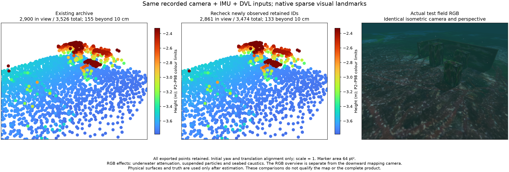

# Retained-map counter-evidence and joint information

2026-10-28. Camera + raw IMU + DVL; experimental native worker. **Map quality
remains unqualified.** Both options default to off in the native research
interface. This record does not enable a qualified application provider.

카메라·원본 IMU·DVL을 사용한 네이티브 연구용 검사입니다. **지도 품질은 아직
불합격입니다.** 두 기능의 기본값은 꺼짐이며 앱 공급자의 품질 검증을 대체하지
않습니다.

The views use the same isometric direction, perspective and bounds. Every
exported point enters projection; 2,900/3,526 existing and 2,861/3,474 rechecked
points lie in view. Markers are 64 pt² with far-to-near drawing and Turbo height
colours. Only colours saturate at P2/P98. RGB includes underwater attenuation,
suspended particles and seabed caustics. The overview camera is separate from
the downward mapping input.

같은 등각 방향·원근·범위로 전체 점을 투영합니다. 기존 지도는 3,526점 중 2,900점,
재검사 지도는 3,474점 중 2,861점이 화면 안에 있습니다. 먼 점부터 64 pt²로 그리며
Turbo 높이 색상만 2–98분위에서 포화합니다. RGB에는 수중 감쇠·부유 입자·해저
집광무늬가 있습니다. 비교 카메라는 기체의 하향 지도 입력과 별개입니다.

## Paired recorded inputs / 같은 기록 입력

All five modes replay the same 16 startup images, measured camera/IMU startup
seed, 638 camera exposures at 5 Hz and 728 state events from 15.7 to 143.2 s.
Native DVL factors use original timestamps. Ping and multibeam sensors are
physically recorded but their factors are off. No truth, ideal orientation or
scene geometry enters estimation. The source native-world run failed with
`worker:image_gap_or_reset`; successful replay does not repair or qualify that
live failure. Raw inputs and all failed controls remain preserved.

다섯 방식 모두 초기 영상 16장, 측정 카메라·IMU 초기화 값, 5Hz 영상 638장과
상태 이벤트 728개를 같은 시각(15.7–143.2초)으로 재생합니다. DVL은 원래 시각의
공동 제약입니다. Ping·멀티빔 측정은 기록에 있지만 이 비교에서는 최적화에 넣지
않습니다. 정답 자세·지형은 추정기에 입력하지 않습니다. 원본 네이티브 월드의
`worker:image_gap_or_reset` 실패는 재생 성공으로 해결된 것이 아닙니다.

## Surface error / 물리 표면 오차

All exported vertices are assessed after estimation against collision boxes and
seabed triangles. Alignment fixes initial yaw and translation only; scale is 1.

- Existing archive: 3,526 points; p95 9.29 cm, p99 45.53 cm, maximum 3.05 m;
  155 points beyond 10 cm.
- Recheck received retained IDs: 3,474 points; p95 8.54 cm, p99 30.74 cm,
  maximum 2.88 m; 133 points beyond 10 cm. There are 157 withdrawal events;
  an ID may obtain fresh support and be admitted again.
- Joint world-position information, with predeclared 10 cm three-sigma budget:
  no mature points, both with and without rechecking. This is a retained
  failure, not an accepted empty map. The budget is not loosened.

추정 이후 전체 점을 충돌 상자·해저 삼각형과 비교합니다. 초기 방위·평행이동만
정렬하고 척도는 1로 고정합니다. 재검사 후 10cm 초과 점은 155개에서 133개로
줄지만 최대 2.88m 오차가 남아 충분한 해결책이 아닙니다. 사전 지정한 지도 위치
3시그마 10cm 기준에서는 두 경우 모두 성숙 점이 0개입니다. 이 실패를 보존하며
빈 지도를 통과시키거나 기준을 낮추지 않습니다.

## Information scope / 불확실성의 범위

Undamped visual rows, the marginal prior, IMU and enabled native auxiliary
factors enter a joint Schur covariance query. Shared nuisance correlations and
null directions remain explicit. Independent dense-inverse controls check the
result. Host-camera and fixed-pose conditional coordinates are diagnostics;
world-position uncertainty remains the metric admission criterion.

At the middle exposure (79.6 s), median principal sigma is 9.54 cm in world
coordinates, 1.91 cm relative to the host camera and 1.60 cm conditional on
fixed poses. A sharp local observation does not certify its global map
coordinate. Neither local sigma replaces the world criterion. Calibration
uncertainty is excluded; covariance consistency is not yet calibrated.

감쇠 전 시각 관측·주변화 사전정보·IMU·활성 보조센서 제약으로 공동 공분산을
계산합니다. 공유 보조변수 상관관계와 관측되지 않은 방향을 보존하며 독립 전체
행렬 역산과 비교합니다. 79.6초의 주축 표준편차 중앙값은 지도 기준 9.54cm,
기준 카메라에 대한 상대 위치 1.91cm, 모든 자세를 고정하면 1.60cm입니다.
가까운 관측의 정밀도가 지도 좌표의 정밀도를 보장하지 않으므로 지도 기준을
유지합니다. 보정 불확실성은 제외하며 공분산 자체의 통계적 적합성도 미검증입니다.

The coordinate diagnostic processes all 638 exposures without a query error,
exports the identical PLY, and changes mean positions by at most 1.32e-13 m.
Native/IPC camera-event time is median 97.2 ms and p95 156.6 ms, excluding NPZ
decode, rendering and assessment. These paced replays do not establish live
renderer/transport throughput or installed-app acceptance.

638장 전체에서 계산 오류는 없고 PLY도 동일합니다. 평균 위치 차이는 최대
1.32e-13m입니다. 네이티브·IPC 처리 중앙값은 97.2ms, 95분위는 156.6ms이며
입력 해제·렌더링·평가는 제외합니다. 이 순차 재생으로 라이브 처리량이나 설치형
앱의 검증을 주장하지 않습니다.

Six affected native test scripts pass, including DVL, pressure, camera-free
state ownership and archive retention. Dense covariance controls cover shared
groups, parameter units, nullspaces and relative versus world coordinates.
The retained-point probe checks moved/rotated cameras, mounted calibration,
retired optimizer IDs, missing observations and three fresh admission exposures.

다섯 모드의 수치 비교·전체 점 표면 평가와 좌표 진단은 아래 JSON에 보존합니다.
초기화 운동에 따른 자세·바이어스 관측 가능성과 실제 오대응은 계속 검증해야 합니다.
공동 Gaussian/Schur 계산과 재투영 일관성 검사는 기존 방법이며 새 연구 기여로
주장하지 않습니다.

- [All-point physical assessment](physical-assessment.json)
- [Coordinate diagnosis](coordinate-diagnosis.json)
- [Mean-state numerical comparison](pose-comparison.json)
- [Input and native-source fingerprints](provenance.json)
- [OpenVINS dynamic initialization options](https://docs.openvins.com/structov__init_1_1InertialInitializerOptions.html)
- [Observability and motion excitation paper](https://ijcai.org/proceedings/2016/624)

[Turning-survey follow-up](../visual-turning-information-20261028/README.md) keeps the metric budget unchanged and records the remaining map and live-delivery failures.
