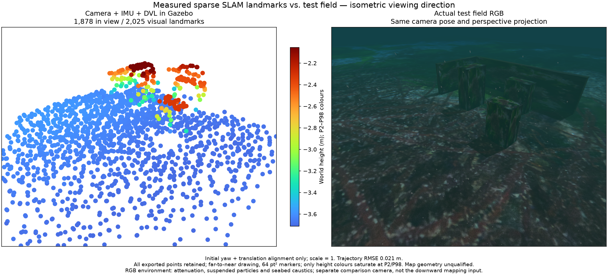

# Live world-position map information / 라이브 세계 좌표 지도 정보

2026-10-28. Camera + raw IMU + DVL in an isolated macOS native development
runtime. **This field passes the recorded 10 cm point/surface check. Broader
SLAM, acoustic-map and installed-app acceptance remain incomplete.**

## Implementation and evidence

The host requests the independent `posim_slam.map_quality` contract: undamped
joint world-position information, a 0.1 m three-sigma budget and stored-point
reprojection checks on received IDs. The ready response and every map report
must acknowledge this policy. Relative host-camera sigma cannot replace world
sigma. Fixed calibration, native position/yaw gauge and the noise model remain
assumptions. The native bare defaults keep these options off; the application
requests them explicitly. No native C++ algorithm or threshold changes here.

A real ROS DVL-outage replay recovers 272 visually constrained poses and a new
959-point export. The first precision-admitted point appears **15.32 s** after
resumption. Its earlier **12 s control fails** with no admissible map, despite
continued tracking; the 60 s source interval includes subsequent turns. The
sensor clock and 10 cm budget remain unchanged. Reporting wording differs in
the short control; its separate source manifest and failure are preserved.

The first field attempt holds position and exports no map; its pre-motion map
requirement fails. For the motion trial, the observer verifies ten visually
constrained poses, then commands the physical ArduSub survey. Final map/export,
trajectory, collision clearance and full point-count checks remain required.
This mission uses simulated external navigation independently of SLAM. Empty
initial geometry is reported as pending, never as mapping success.

The fresh field run completes its mission in **75.48 s** with **1.340 m** minimum
observed body-centre clearance. The 120 s moving observation retains one segment
and **600 poses**. Exit is 0, with no forced shutdown or remaining owned process.

- Complete map: **2,025 points**; **1,878** lie within the comparison camera.
- Trajectory position RMSE: **2.09 cm**.
- All-point surface error: median **0.74 cm**, P95 **1.72 cm**, P99 **2.68 cm**.
- Maximum surface error: **5.62 cm**; **0/2,025** exceed 10 cm.
- Default viewer: **1,000** points. Other choices show 2,000 / 2,025 / 2,025.
- Stored-point reprojection checks withdraw **44** entries by the final status.

The source receives zero inbox rejections and no queue fault. The intentionally
killed worker discards two queued packets at reset. The largest recorded status
serialization/write call is **796 ms**, with peak queued payload **11,738,192
bytes**. Status-observed camera counters account for 1,200 source intervals over
21.7–141.7 s at 10 Hz; IMU counters account for 11,987 intervals over
21.75–141.62 s at 100 Hz. No interval is unaccounted between those observations.
This does not certify all overload conditions or hard real-time deadlines.

Every exported vertex enters assessment and projection. Geometry is not trimmed
using truth. Alignment uses initial yaw/translation after estimation, with scale
fixed at one. RGB and cloud use the same observer camera and bounds. RGB includes
underwater attenuation, suspended particles and seabed caustics; this overview
camera is separate from the downward estimator camera. Markers are 64 pt²,
drawn far to near, with Turbo height colours. P2/P98 affects colour only.

This is a fresh physical recording, not a paired ablation against the earlier
receiver field. The earlier [same-input turning controls](../visual-turning-information-20261028/README.md)
and their remaining outliers are preserved. This result does not qualify other
sensor combinations, all terrain/lighting conditions, installed GUI operation,
Windows/Linux or calibrated uncertainty. Sonar echo/surface association and
the combined acoustic recovery failure remain unresolved.

A freshly built independent wheel imports the map contract after relocation
to a path with spaces, under `python -I`, without ROS/application imports. The
contract unit controls, affected owner/recording checks and public-document
audits pass. EN/KO desktop/mobile pages are rendered and inspected.

## 한국어

독립된 `map_quality` 계약으로 자세를 포함한 공동 위치 정보, 세계 좌표 3시그마
0.1m 한도와 저장점 재투영 검사를 라이브 경로에 요청합니다. 준비 응답과 각 지도
보고서를 검증하며 카메라 상대 오차로 대신하지 않습니다. 고정 보정값·초기 위치와
방위 기준·잡음 모델은 가정입니다. C++ 알고리즘이나 채택 문턱은 바꾸지 않았습니다.

실제 ROS DVL 중단 시험은 새 구간에서 시각 제약 자세 272개와 지도 959점을 복구합니다.
정밀도 기준을 만족하는 첫 점은 재개 **15.32초** 뒤에 나타납니다. **12초 대조는 실패**로
보존했고, 후속 회전을 포함한 60초 구간에서 복구합니다. 짧은 대조는 상태 설명 문구가
바뀌기 전 소스이므로 별도 해시와 함께 보존합니다.

정지한 첫 네이티브 실행은 지도 0점으로 실패합니다. 이동 시험은 시각 제약 자세 10개를
확인한 뒤 실제 조사 항로를 시작하고, 이동 후 지도·전체 다운로드·궤적·충돌 여유를
모두 검증합니다. 항로 제어의 시뮬레이션 외부 항법과 SLAM은 독립적입니다. 초기 빈
지도를 지도 생성 성공으로 처리하지 않습니다.

새 실행은 **75.48초**에 임무를 마치고 최소 기체 중심 여유 **1.340m**를 유지합니다.
120초 이동 관측에서 같은 구간의 자세 **600개**, 지도 **2,025점**을 보존합니다.
궤적 RMSE는 **2.09cm**, 전체 점의 표면 오차는 중앙값 **0.74cm**, 95분위 **1.72cm**,
99분위 **2.68cm**, 최대 **5.62cm**입니다. 10cm 초과 점은 **0개**입니다.
뷰어 기본 표시는 1,000점이고 전체 PLY는 2,025점입니다. 마지막 상태까지 재투영
검사로 저장점 44개를 제거했습니다. 강제 종료나 잔류 소유 프로세스 없이 종료합니다.

수신 거부·큐 오류는 0이며 의도한 작업자 재시작에서 대기 패킷 2개를 비웠습니다.
상태 직렬화·저장 호출의 기록상 최대는 796ms, 최대 큐 페이로드는 11,738,192바이트입니다.
영상 21.7–141.7초의 1,200개 간격과 IMU 21.75–141.62초의 11,987개 간격이
각각 10Hz·100Hz 수신 횟수와 일치합니다. 모든 과부하나 경성 실시간을 보증하지 않습니다.

전체 점을 평가하며 정답 지형으로 자르지 않습니다. 추정이 끝난 뒤 초기 방위·이동만
맞추고 축척은 1로 유지합니다. RGB와 점군은 같은 관찰 카메라·투영 범위를 사용합니다.
RGB의 수중 효과는 감쇠·부유 입자·해저 집광무늬이며 하향 입력 카메라와 별개입니다.
점은 64 pt²·먼 순서·Turbo 높이 색으로 표시하며 2/98분위는 색에만 적용합니다.

이 실행은 별도의 실제 기록이므로 이전 수신 실행과 동일 입력 대조로 해석하지 않습니다.
기존 동일 입력 대조와 잔류 오차도 보존합니다. 다른 센서 조합·지형·조명·설치형 GUI·
Windows/Linux 검증은 남아 있습니다. 소나 반사점 연결과 복합 음향 지도 복구도 미완료입니다.

새로 만든 독립 wheel을 공백이 있는 경로로 옮긴 뒤 `python -I`에서 ROS·앱 없이
가져옵니다. 계약 단위 검사와 관련 소유자·기록 검사가 통과하며 영한 문서의
데스크톱·모바일 렌더링과 감사를 확인했습니다.

- [Native field, timing and source-clock evidence](native-summary.json)
- [Every assessed vertex](surface-evaluation.json)
- [Full exported local-frame PLY](map.ply)
- [Shared camera, alignment and complete-map projection](comparison.json)
- [Short-recovery failure](short-recovery-failure.json)
- [Turning recovery](turning-recovery.json)
- [Stationary precondition failure](stationary-precondition-failure.json)
- [Eight runtime files, 71 component sources and SDK identity](source-manifest.json)
- [Independent wheel relocation](wheel-relocation.json)
