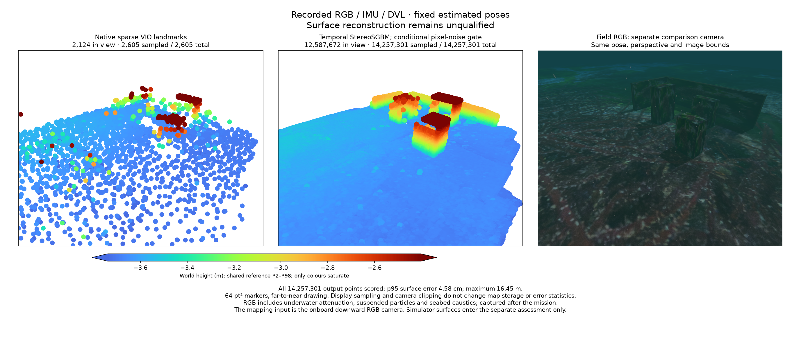

# Temporal stereo and camera coverage / 시간차 스테레오와 촬영 범위

2026-10-27. **Offline references**, using recorded RGB / IMU / DVL and fixed
estimated VIO poses. Live integration and complete-map qualification remain open.
The [earlier OpenSfM references](../visual-dense-reference-20261027/README.md)
and all failed outputs remain intact. Every generated point is scored.

기록한 RGB·IMU·DVL과 추정 VIO 자세를 고정한 **오프라인 기준실험**입니다.
실시간 통합과 지도 검증은 아직 완료되지 않았으며 기존 결과·실패를 모두 보존합니다.

The clouds and actual field RGB share one isometric viewing direction,
perspective and camera bounds. Full clouds enter projection; labels show total
and in-view counts. Points draw far to near at 64 pt² with shared P2–P98
blue-to-red Turbo heights. Only colours saturate. RGB includes underwater
attenuation, particles and seabed caustics. This comparison camera is separate
from the onboard downward mapping input.

점군과 RGB는 등각 방향·원근 투영·카메라 범위가 같습니다. 전체 점을 투영하고
전체·화면 안 점 수를 표시합니다. 점 크기는 64 pt²이며 먼 점부터 그립니다.
공통 높이 2–98분위의 파랑→빨강 Turbo에서 색상만 포화시킵니다. RGB에는 수중
감쇠·부유 입자·해저 집광무늬가 있으며 비교 카메라와 기체 하향 입력을 구분합니다.

## Acquisition and inputs / 촬영 경로와 입력

The 7 m × 4 m two-lane mission completes with 0.776 m swept body-centre
clearance, 1.51 cm trajectory RMSE, 2,605 sparse points and clean shutdown.
The second wall's three-view potential increases from 2.72% to 56.66% relative
to the 2.4 m strip; selected views also satisfying point-specific 3°–30° parallax
give 1.79% versus 55.56%. These are **upper bounds** with box occlusion, not
pixel correspondence or seabed visibility. The highest roof's potential falls
to 26.14%; strip width alone does not ensure uniform coverage.

폭을 2.4m에서 4m로 넓히면 두 번째 벽의 3시점 관측 가능 비율은 2.72%에서
56.66%로 늘지만, 가장 높은 물체 상부는 26.14%만 관측 가능합니다. 상자 가림을
포함한 **상한값**이며 픽셀 대응·해저 가시성을 입증하지 않습니다. 조사 폭만으로
고른 촬영 범위를 확보할 수 없습니다.

The previous experiment supplied all frontend IDs with each ID's last
full-weight estimated position, rather than per-image inlier-only observations.
Enforcing that input contract changes 454 / 490 old neighbour lists. New graphs
retain only each image's full-weight observations and preserve empty-neighbour
images. This is an explicit policy change; it does not establish that every
earlier untriangulated observation was a wrong physical match.

기존 실험은 모든 프런트엔드 ID와 ID별 마지막 유효 추정점을 사용했으며 영상별
유효 관측만의 그래프는 아니었습니다. 영상별 조건을 적용하면 기존 490개 중
454개 인접 목록이 바뀝니다. 정책 차이를 명시하며 기존 관측이 모두 잘못된
대응이었다고 단정하지 않습니다.

## Depth methods / 깊이 복원 방법

OpenCV **4.13.0** rectification and `StereoSGBM` (`SGBM_3WAY`) use 400 × 300
images and measured covisibility with estimated 0.2–0.8 m baselines. The unchanged
OpenSfM **65571c8** cleaner requires three depth views agreeing within 1%.
Of 491 images, 279 have eligible pairs; 212 keep zero depth. Future views and
repeated surface samples remain in this batch.

| Offline result / 오프라인 결과 | Baseline / 기본 | Pixel-noise control / 픽셀 잡음 조건 |
| --- | ---: | ---: |
| Full points / 전체 점 | 14,257,265 | 14,257,301 |
| p95 surface error / 표면 오차 95분위 | 4.58 cm | 4.58 cm |
| Maximum / 최대 | **77.88 m** | **16.45 m** |
| Beyond 10 cm / 10 cm 초과 점 | 1,246 | 1,240 |
| Reconstruction / 복원 시간 | 22.62 s | 22.99 s |
| Median stereo call / 스테레오 호출 중앙값 | 10.08 ms | 10.22 ms |
| Maximum RSS / 최대 RSS | 1,232.7 MiB | 1,203.0 MiB |

The control assumes **1 px** disparity sigma and requires `abs(disparity)>3 sigma`.
Pose uncertainty and physical correspondence are not certified. Cleaning and
interpolation run again, so final admitted sets are not asserted to be nested.
Both maps **fail qualification**: target 1 roof coverage is 0%, and the second
wall reaches about 42.7% proximity within 5 cm. The old PatchMatch case has
different mission/input policies, so timings are not an isolated kernel
comparison. Raw-call timing excludes rectification, I/O, fusion, GPU and SLAM.

픽셀 잡음 조건은 시차 표준편차를 1픽셀로 가정하고 3시그마 초과를 요구합니다.
자세 불확실도·물리 대응은 검증하지 않습니다. 재보간·일관성 검사로 최종 점 집합은
단순 포함 관계가 아닐 수 있습니다. 두 결과 모두 두 번째 물체 상부를 복원하지
못하고 먼 이상점이 남아 **불합격**입니다. 기존 PatchMatch와 입력·경로가 다르므로
순수 계산기 속도만의 짝비교가 아니며 실시간 통합을 입증하지 않습니다.

Synthetic axis/sign controls preserve exact unrotated plane depth; resampled
rotation controls retain 3–5 cm median errors and fail an initial 1.5 cm tolerance.
Blank images give zero points. Separate 1/2/10-pixel controls confirm the raw
significance gate and zero-sigma agreement. Exact triangle distances are checked
independently. Bounded assessment batches retain compressed per-point evidence.

## Retained lifecycle failure / 보존한 실행 실패

A generic three-lane fixed-depth route adds the middle strip without target
locations. The physical mission completes in 74.12 s with 1.319 m clearance.
The full 120 s observation fails: after mission completion the worker reports
`image_gap_or_reset` and changes segment. Source camera gaps remain at most
0.2 s and IMU gaps 0.01 s. The compound worker guard also checks ordering; its
failure does not prove a source outage. No map is exported or accepted. Raw
inputs and clean process shutdown remain for protocol investigation.

가운데 조사선을 포함한 일반 경로는 물체 위치 없이 생성하며 임무는 74.12초에
완료됐습니다. 그러나 전체 120초 관측에서는 임무 후 워커 입력 시계 검사로 구간이
바뀌어 실패했습니다. 원본 영상 간격은 최대 0.2초, IMU는 0.01초입니다. 시각 순서도
확인하는 검사이므로 센서 단절로 단정하지 않습니다. 지도를 내보내거나 합격 처리하지
않고 원본 입력·상태 전환·정상 종료를 보존합니다. 검사 기준을 완화하지 않습니다.

## Evidence and notices / 근거와 고지

[Native run](wide-native-run.json), [narrow coverage](narrow-input-coverage.json),
[wide coverage](wide-input-coverage.json), [observation policy](observation-policy-audit.json),
[baseline summary](baseline-summary.json), [baseline assessment](baseline-assessment.json),
[baseline figure](baseline-comparison.png), [pixel-noise summary](pixel-significance-summary.json),
[all-point assessment](pixel-significance-assessment.json),
[face coverage](pixel-significance-surface-coverage.json), [plot metadata](pixel-significance-plot.json),
[lifecycle failure](three-lane-retained-failure.json).
Complete PLYs, numeric fields and sensor inputs stay on the external disk; hashes
and sizes are recorded without copying large generated data into Git.

[OpenCV StereoSGBM](https://docs.opencv.org/4.13.0/d2/d85/classcv_1_1StereoSGBM.html)
and [Apache-2.0](https://github.com/opencv/opencv/blob/4.13.0/LICENSE);
[OpenSfM 65571c8](https://github.com/mapillary/OpenSfM/tree/65571c8ae9ac6a1d0bcd3fdc1ea5fff97b1b5611)
and [retained BSD-2-Clause notice](../visual-dense-reference-20261027/opensfm-license.txt);
[Orca5 MIT notice](../visual-dense-reference-20261027/orca5-license.txt).
These established methods carry no new research-method claim.
