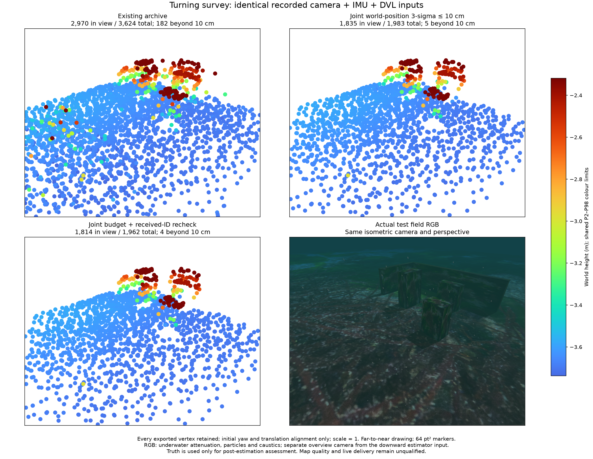

# Turning survey and joint map information

2026-10-28. Recorded camera + raw IMU + DVL. **Offline map quality and live
transport remain unqualified.** The native research switches retain their off
defaults. The complete original goal and installed-app acceptance remain open.

카메라·원본 IMU·DVL 기록으로 조사 경로와 지도 정보를 비교합니다. **오프라인 지도
품질과 라이브 전달은 아직 불합격입니다.** 연구용 기능의 기본값은 꺼짐으로 유지하며
전체 목표와 설치형 앱의 검증은 완료되지 않았습니다.

All exported points enter the same isometric-camera projection. The existing
archive shows 2,970/3,624 points in view; the joint world-position metric shows
1,835/1,983. The third panel adds received-ID rechecking. All three use shared
P2/P98 limits computed over their complete exports. Far-to-near 64 pt² markers use Turbo heights with P2/P98 colour
saturation only. RGB includes attenuation, particles and seabed caustics. This
overview camera is separate from the downward estimator camera.

전체 점을 같은 등각 방향·원근·범위에 투영합니다. 기존 3,624점 중 2,970점,
공동 지도 위치 기준 1,983점 중 1,835점, 재검사 적용 1,962점 중 1,814점이 화면
안에 있습니다. 먼 점부터 64 pt²로 그리며 세 점군 전체의 공통 2–98분위에서
높이 Turbo 색상만 포화합니다. RGB에는 감쇠·입자·해저
집광무늬가 있습니다. 비교 카메라는 기체의 하향 추정 카메라와 별개입니다.

## Measured route and replay / 측정 경로와 재생

The physical 7 m × 4 m, three-lane mission follows its travel direction rather
than holding inspection yaw. It completes in 73.48 simulated seconds with
1.278 m minimum observed body-centre clearance. Estimated unwrapped yaw spans
348.81°, versus 9.67° in the separate held-heading recording. These are separate
physical recordings, not a controlled attribution of covariance to one variable.

같은 길이 7m·폭 4m의 세 줄 경로에서 진행 방향에 맞춰 회전합니다. 물리 임무는
73.48초에 완료됐고 관측한 최소 기체 중심 여유는 1.278m입니다. 추정 방위의 연속
변화 범위는 348.81°이며, 별도의 방위 고정 기록은 9.67°입니다. 서로 다른 물리
기록이므로 공분산 차이의 원인을 한 변수로 확정하지 않습니다.

The paired replays use the same measured startup history and seed, 629 images
at 5 Hz, and 755 state events from 15.9 to 141.5 s. The frozen acquisition
worker is `5f9e9066`; the new native replay worker and source fingerprints are
recorded in JSON. Ping/multibeam observations are recorded, but their factors
are off. No truth, ideal orientation or scene geometry enters estimation.

재생에서는 측정 초기 이력·초기화 값, 5Hz 영상 629장, 상태 이벤트 755개를 원래
시각 15.9–141.5초로 사용합니다. 수집 작업자는 고정 버전이며 네이티브 재생의
실행 파일·소스 해시는 JSON에 보존합니다. Ping·멀티빔 기록은 있지만 이 비교의
최적화에는 넣지 않습니다. 정답·이상적 자세·장면 기하는 추정기에 입력하지 않습니다.

## Complete-map errors / 전체 지도 오차

Every exported vertex is assessed against collision boxes and seabed triangles
after estimation. Initial yaw and translation are aligned; scale remains 1.

- Existing archive: **3,624 points**, p95 **10.04 cm**, maximum **6.52 m**;
  **182** points exceed 10 cm.
- The unchanged world-position **three-sigma ≤10 cm** budget: **1,983 points**,
  p95 **1.69 cm**, p99 **2.56 cm**, maximum **72.35 cm**; **5** exceed 10 cm.
- The same budget plus received-ID rechecking: **1,962 points**, p95 **1.67 cm**,
  p99 **2.44 cm**, maximum **72.35 cm**; **4** exceed 10 cm. There are 41
  withdrawal events, including candidates that never mature.

정답 표면은 추정 이후의 평가에만 사용합니다. 전체 점을 유지하고 초기 방위·평행이동만
정렬하며 척도는 1입니다. 동일한 지도 위치 3시그마 10cm 기준은 방위 고정 기록에서
성숙 점을 만들지 못했지만 이번 기록에서는 1,983점을 저장합니다. 재검사를 함께
적용하면 1,962점 중 4점이 10cm를 넘고 최대 72.35cm 오차가 남습니다. 개선은
분명하지만 남은 오대응·체계 오차를 조사해야 하며 지도 합격으로 인정하지 않습니다.

Position RMSE is 2.08 cm and maximum is 3.54 cm. Metric gating/rechecking do
not change the estimated mean trajectory beyond numerical roundoff. All 629
information queries in each enabled replay succeed. Native/IPC camera-event
median/p95 are 77.5/120.5 ms for the metric and 73.3/122.8 ms with rechecking;
NPZ decode, rendering and assessment are excluded. Calibration is fixed, and
covariance consistency is not calibrated. These paced runs do not prove live
throughput, loop closure, all sensor combinations or installed distribution.

위치 RMSE는 2.08cm, 최대는 3.54cm이며 필터링·재검사는 평균 궤적을 수치 오차
이상 바꾸지 않습니다. 활성 재생마다 629회 정보 계산에 오류가 없습니다. 처리 시간은
입력 해제·렌더링·평가를 제외하며 공분산 적합성·라이브 처리량·다른 센서 조합·설치형
배포의 검증을 대신하지 않습니다.

## Retained live failure and archive cost / 보존한 라이브 실패와 기록 비용

The source live run resets its map segment at `image_gap_or_reset` and fails
acceptance. Its independent recorder preserves all 1,321 received camera
exposures with a maximum 0.1 s gap and raw IMU with a 0.01 s gap, without
recording errors. At 88.5–89.1 s the VIO subscription skips five camera
exposures that are present in the independent archive. Its history depth is 5.
The callback stall cause is not yet attributed. No clock guard is weakened.
The runtime exits normally with no remaining owned process. The earlier failed
startup from a mismatched provider descriptor is also preserved locally.

라이브 실행은 영상 시간 간격 오류로 지도 구간이 바뀌어 불합격입니다. 독립 기록의
영상 1,321장은 최대 간격 0.1초, IMU는 0.01초로 연속이며 기록 오류가 없습니다.
88.5–89.1초에 VIO 구독자가 놓친 영상 5장도 원본 기록에는 있습니다. 구독 큐 깊이는
5장이며 콜백 지연 원인은 아직 확정하지 않았습니다. 시간 검사를 완화하지 않았고
정상 종료 후 소유 프로세스가 남지 않았습니다. 별도의 공급자 불일치 시작 실패도
로컬 기록에 보존합니다.

The optional estimator-gray8 archive retains exact worker-input pixels at the
original dimensions/times without changing the live subscription. Stored
uncompressed pixels are 634,080,000 bytes versus 1,902,240,000 incoming source
bytes. In a separate 12-frame sample, NPZ size is 3,020,053 versus 10,092,913
bytes; replay-pixel hashes match for every frame. RGB field/reference captures
are kept separately. This reduces archive cost without proving a clock fix.

선택한 회색조 기록은 추정기 입력 픽셀·해상도·시각을 그대로 보존합니다. 저장 픽셀은
634,080,000바이트이며 수신 색상 원본은 1,902,240,000바이트입니다. 별도 12장
표본의 NPZ 크기는 원본 10,092,913바이트, 회색조 3,020,053바이트이며 입력 픽셀
해시가 모두 같습니다. 비교용 RGB는 별도 보존하며 기록량 감소를 시간 오류 해결로
주장하지 않습니다.

- [Complete-point and trajectory statistics](summary.json)
- [Five metric-mode outlier histories before rechecking](outlier-histories.json)
- [Live subscriber discontinuity](live-clock-failure.json)
- [Camera archive sample](camera-archive-benchmark.json)
- [Actual simulator identity](simulator-identity.json)

- [Shared figure colour policy](figure-policy.json)
